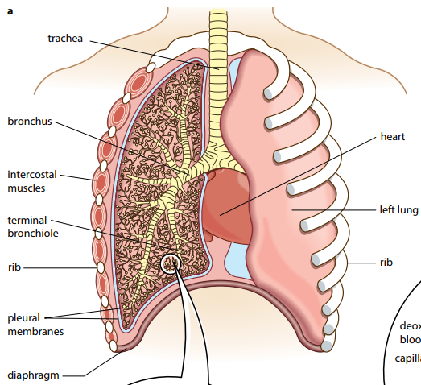

## The Mammalian Gas Exchange System

* **Gross structure of lungs:** lungs are in chest cavity surrounded by the pleural membranes, which enclose an airtight space. This space contains a small quantity of fluid to allow friction-free movement as the lungs are ventilated by the movement of the diaphragm and ribs. 

* **Bronchi:** branch to form smaller bronchioles.
  * Bronchioles are surrounded by **smooth muscle,** which can
    contract or relax to adjust the diameter of these tiny airways
    due to the absence of cartilage. During exercise, the muscles
    relax to allow a greater flow of air to the alveoli.
* **Cartilage:** It is a connective tissue. It keeps airways in
  trachea and bronchi open and air resistance low and prevents them
  from collapsing or bursting as the air pressure changes during
  breathing.
* **Epithelium:** Air flows down the lungs through trachea and
  bronchi, which are lined by cells adapted to remove particles from
  the air before it reaches the lungs. These cells make up a tissue
  called epithelium. **There are two main kinds:**
  * **Ciliated cells:** They are responsible for the continual
    movement of mucus towards the larynx.
  * **Goblet cells:** Secretes mucus that traps pathogens, which are
    then moved out with the help of cilia.

||**Adaptations for efficient gas exchange**|
|:---|:---|
|**Large surface area**|A large number of alveoli is present to increase the surface area|
|**Thin surface**|The wall of the alveolus is very thin (single layer of squamous epithelium) to decrease the diffusion distance. Also, the walls of the capillaries are thin.|
|**Steep concentration gradient**|Deoxygenated blood is brought to the alveoli which provides a steep concentration gradient for diffusion|
|**Moist surface**|Allowing dissolving of gases|
|**Ventilation**|Replacing alveolar air with air from outside the body. This helps maintain the diffusion gradient.|
