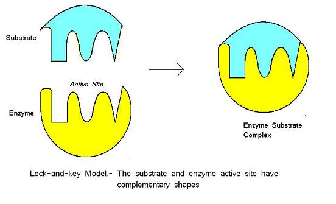
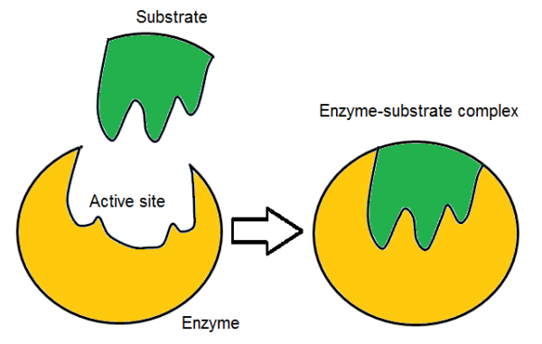
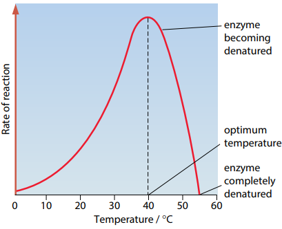
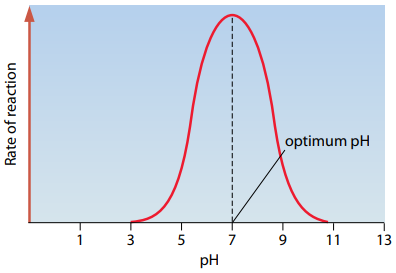

## Enzymes

- An enzyme is a biological catalyst that accelerates metabolic reactions. Enzymes are globular proteins as they have a roughly spherical shape and are water-soluble. Enzymes functioning inside a cell are intracellular, but those that are secreted by cells and catalyse reactions outside cells are described as extracellular.

- Enzymes have specific active sites that are complementary to the shape of the substrate. The substrate is held in place at the active site by weak hydrogen and ionic bonds. The combined structure is called **the enzyme-substrate complex**.

- Activation energy is the energy required in any chemical reaction to break the bonds in reactant molecules so that new bonds are formed to make the product. An enzyme lowers the activation energy required for the reaction. However, the overall energy released during the reaction is maintained.

- **Lock**-**and-key theory**: the shape of the active site is exact and substrates that are not complementary to the shape of the active site cannot bind. The enzyme-substrate complexes formed to enable the reaction to take place more easily.

- **Induced fit theory**: the enzyme’s active site is not initially an exact fit to the substrate molecule. However, the enzyme molecules are more flexible and can change shape slightly as the substrate enters the enzyme. This means that the enzyme molecule will undergo conformational changes as the substrate combines with the enzyme’s active site, forming the enzyme-substrate complex.

### **Factors Affecting Enzyme Action**:

- **Temperature**: As the temperature increases, the kinetic
  energy and the enzyme activity increases as there’s more
  collisions until optimal temperature is reached (usually 40C).
  At optimum temperature, maximum rate of reaction is achieved. If
  the temperature continues to increase beyond the optimum
  temperature, the rate of the reaction begins to decrease as more
  kinetic energy breaks the bonds in the secondary and tertiary
  structure of the enzyme. This changes the shape of the enzyme
  and it’s active site and causes the substrate to no longer fit.
  The enzyme is denatured.

- **pH:** Any change in the pH value of the medium around the enzyme will cause the bonds to be damaged, this will change the 3-D shape of the enzyme and deform the active site. Therefore, the substrate will not be able to fit into active site thus the reaction slows down or stops. The enzyme gets denatured.

- **Enzyme concentration:** As the concentration of enzymes is increased, there are more available active sites for substrates to fit into. More enzyme-substrate complexes are formed, more products are formed and the rate of reaction is increased. At the beginning, the limiting factor is the enzyme concentration. Once all substrates have formed enzyme-substrate complexes, a further increase in enzyme concentration will have no effect on the rate of reaction. At this point, the limiting factor is the substrate concentration.

- **Substrate concentration:** As the concentration of substrate increases, the greater the chance of collision with enzymes, the more enzyme-substrate complexes formed, the more products formed and the greater the rate of reaction. At the beginning, the limiting factor is the substrate concentration. Once all the enzymes are occupied and working at their maximum rate (vmax), a further increase in substrate concentration will have no effect on the rate of reaction. At this point, the limiting factor is the enzyme concentration.

**Why do we measure the initial rate?**

- There are enough substrate molecules present to ensure that
  substrate concentration is not a limiting reactant

- The substrate concentration is only known at the beginning of
  the reaction