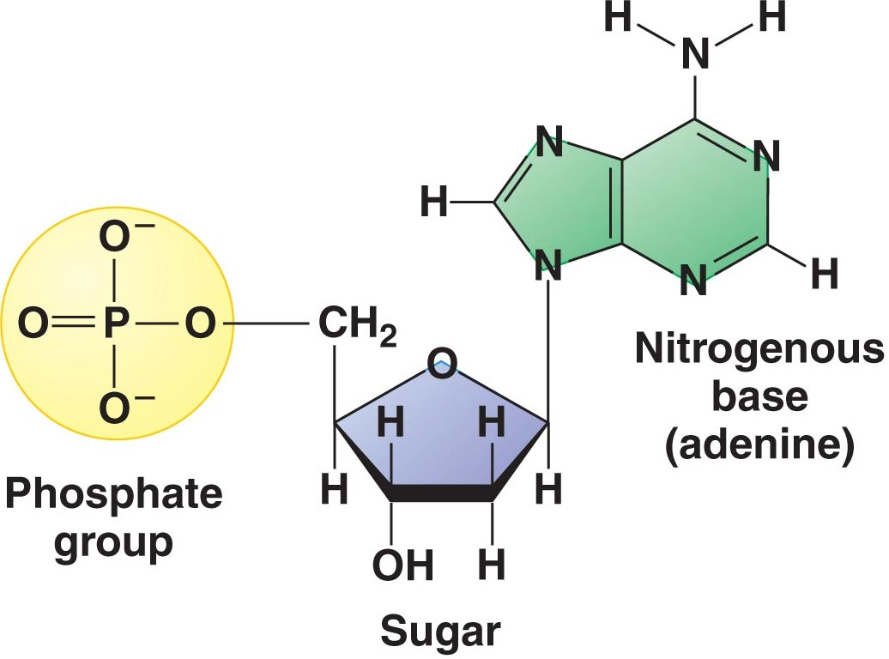
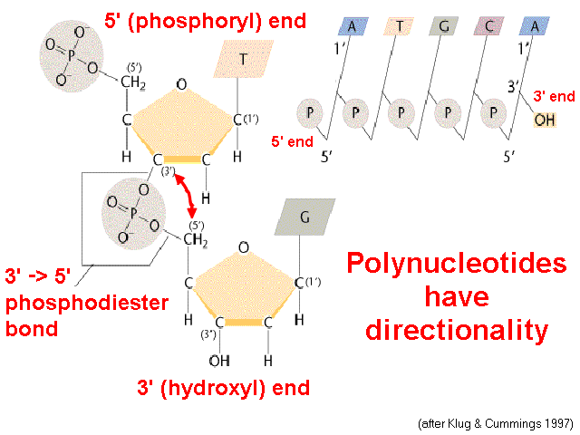
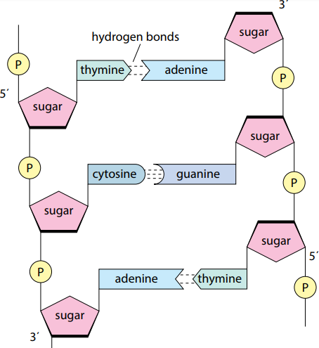

## The Structure of DNA and RNA

### **Nucleic** **Acids**:

* Made up of Carbon, Hydrogen, Oxygen, Nitrogen, and Phosphorus

* Monomers called nucleotides make up nucleic acids

* They are made up of a pentose sugar, organic nitrogen base, and phosphate group

* DNA molecules are double-stranded, RNA molecules are
  single-stranded

### **Polynucleotide**

* **Polynucleotide:** many nucleotides are linked together into a long
  chain-forming polynucleotides DNA/RNA.

* Phosphodiester bonds formed by condensation reactions link the
  5-carbon of one sugar molecule and the 3-carbon of the next. The
  polynucleotide strand is said to have 3΄ and 5΄ ends

### **Pentose Sugars**:

* Ribose ($C\\_{5}H\\_{10}O\\_{5}$) present in RNA nucleotides
* Deoxyribose ($C\\_{5}H\\_{10}O\\_{4}$) present in DNA nucleotides

### **DNA:**

* **DNA** is made up of two antiparallel polynucleotide strands lying
  side by side, held together by hydrogen bonds. These strands are
  arranged into a ladder-like structure called a double helix. The
  phosphate and the deoxyribose sugar form the backbone of the DNA
  molecule while the base pairs form the rings. **It has 4 nitrogenous
  bases:** Adenine, thymine, guanine, and cytosine.

* **Complementary base pairing:** between *Adenine* and *thymine*
  (or Adenine and *uracil* in RNA) and between *guanine* and
  *cytosine*. Because of complementary base pairing, the order of
  the bases in one strand determines the order of the bases in the
  other strand. Therefore, the strands are complementary to each
  other as well.

  * **Purines** are nitrogenous bases with double ring
    structures (Guanine and Adenine).

  * **Pyrimidines** are nitrogenous bases with single ring
    structures (Thymine, Uracil, and Cytosine).

  * Adenine and Thymine form 2 hydrogen bonds, Guanine and
    Cytosine, form 3.

### **RNA:**

* **RNA:** a single stranded polynucleotide chain present in the
  nucleus, cytoplasm and ribosome. It contains a pentose sugar
  (ribose) and has 4 nitrogenous bases: Adenine, Uracil, Guanine and
  Cytosine. The different types of RNA include:

  * **mRNA (messenger RNA):** carries the genetic information in the
    form of a template from the nucleus to the ribosome for translation.

  * **tRNA (transfer RNA)**: has a specific amino acid at one end and an
    anticodon at the other end. It fits onto the mRNA at ribosomes at
    complementary mRNA codon for protein synthesis.

||**DNA**|**RNA**|
|:---|:---|:---|
|**Strands**|Double-Stranded|Single Stranded|
|**Nitrogen Bases**|Contains Thymine|Contains Uracil|
|**Structure**|Helical Structure|Linear Structure|
|**Pentose Sugar**|Contains Deoxyribose sugar|Contains Ribose Sugar|
