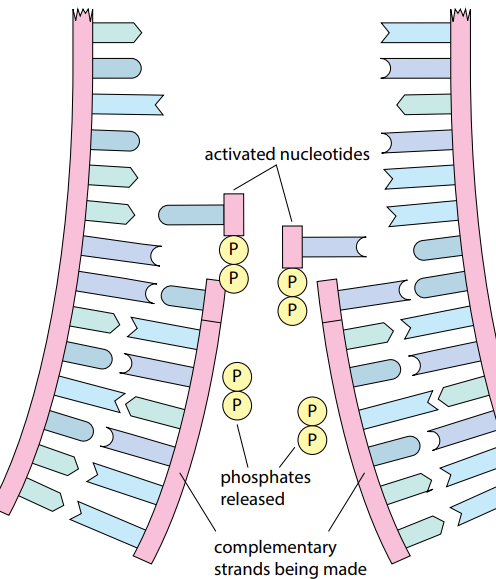
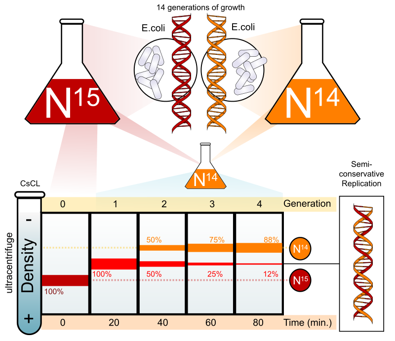

## DNA Replication

**Semi-conservative replication of DNA**: The DNA separates into two
strands, and each strand acts as a template. Each new DNA molecule
consists of one old strand and a complementary new strand.

- A template is a length of polynucleotide chain on to which nucleotides attach to start the synthesis of a complementary sequence

- The DNA double helix unwinds and ‘unzips’ as the hydrogen bonds between the bases break by DNA helicase.

- In the nucleus, there are free nucleotides that pair up by complementary base pairing on each of the old DNA

- DNA polymerase links adjacent nucleotides to each other by catalysing phosphodiester bonds.

- Hydrogen bonds form within the structure, allowing it to coil up into a double helix

**Meselson and Stahl’s experiment:**

- Stahl and Meselson devised an experiment to prove the theory of semi-conservative replication

- They grew a culture of bacteria in a medium of Heavy Nitrogen ($\\_15$N) only

- The bacteria culture used the heavy Nitrogen to produce DNA and different proteins, and after many generations, all of the DNA within the bacteria contained heavy Nitrogen only

- Bacteria were then moved into a medium of Normal Nitrogen ($\\_14$N)

- Bacteria were grouped and left to divided for one generation, two generations, and three generations

- Bacterial DNA was extracted and placed in a centrifuge

- In a centrifuge, the heavier the item, the lower its position is

- The original bacteria formed a single band of DNA at the bottom

- The 1st generation formed a single band at the middle

- The 2nd generation formed two bands, one at the centre and one up the top, of equal thicknesses

- The 3rd generation also formed two bands similar to the 2nd generation, but the top band was thicker than the middle

- If conservative replication were taking place, the 1st generation would contain 2 bars upon centrifugation.

