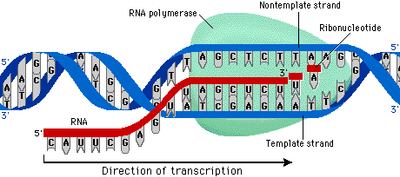
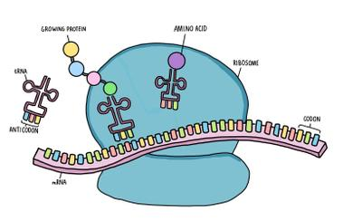

## Protein Synthesis

* **Nature of genetic code**:
  * Made up of a **Triplet code:** There are 20 different amino acids,
    and 4 Nitrogen Bases. Therefore minimum code length must be 3. 4$^{2}$ = 16 \| 4$^{3}$ = 64
  * **Non-overlapping**: e.g. AGGTCA will be read as AGG and TCA only and not AGG, GGT, GTC, TCA
  * **Degenerate:** Multiple Triplet codes code for 1 amino acid
* **Gene**: A sequence of bases on a DNA molecule coding for a sequence of amino acids that control body characteristics of an organism.
* **Codon**: A sequence of 3 bases in DNA or mRNA (messenger RNA).
* **Sense Strand**: The DNA strand carrying the code for the protein being coded
* **Antisense Strand**: The DNA strand acting as a template for the mRNA molecule

**Transcription:**

* DNA Helicase breaks the Hydrogen bonds in the gene forming the sense and antisense strands.
* RNA nucleotides line up with their complimentary base on the Antisense strand.
* Phosphodiester bonds form between sugar phosphate groups with the help of RNA polymerase.
* Hydrogen bonds between the DNA and mRNA strand are then broken.
* mRNA strand is formed then leaves the nucleus through the nuclear pores.

**Translation:**

* mRNA is attached to a ribosome.
* tRNA (transfer RNA) carries one amino acid on it and has an anticodon
* The anticodon of the tRNA complementary to the codons on the mRNA gets attached.
* Each mRNA has a start codon “AUG” which is complementary to the anticodon UAC which carries the *Methionine* amino acid.
* A second tRNA attaches to the next codon on the mRNA similarly.
* The amino acids join together through a peptide bond
* The first tRNA is removed and leaves behind the amino acid.
* The ribosome moves the mRNA to the next codon.
* A third tRNA attaches to the next codon on the mRNA similarly as the first and second.
* The process repeats until a stop codon is reached.
  * Stop codons: UAA, UGA, UAG.
* The mRNA and the polypeptide chain pulls away from the ribosome.

