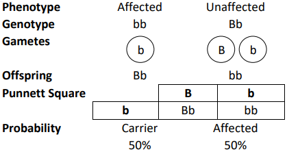

## Patterns of Inheritance

* **Alleles:** are different varieties of a gene occupying the same
  locus.
* **Genotype:** the genetic make-up of an organism formed by alleles, e.g. the alleles $Hb^A$ $Hb^S$ form the genotype: $Hb^{A}Hb^{S}, Hb^{S}Hb^{S},
  Hb^{A}Hb^{A}$
* **Phenotype**: The observable features of an organism resulting from interactions between its genotype and environment
* **Heterozygote**: An individual carrying 2 different alleles coding for a certain characteristic.
* **Homozygote**: An individual carrying 2 identical alleles coding for a certain characteristic.
* A **dominant** allele is one whose effect on the phenotype of a heterozygous is identical to one of a homozygote.
* A **recessive** allele is one who does not express itself when a dominant gene is present.
* **Codominance: Both alleles are expressed in the** phenotype of a heterozygous organism.
* A **monohybrid** cross is a mating between two individuals with different alleles at **one genetic locus** of interest.
* A **test cross** is a genetic cross in which a dominant allele is crossed with a homozygous recessive organism; the offspring phenotypes can determine whether the parent is homo/hetro dominant

### **Drawing Genetic Diagrams**

* A red-green colour-blind father and an unaffected heterozygous mother had a child. Determine the probability of this child being red-green colour-blind. Use a genetic diagram to support your answer.

### **Answer:**

