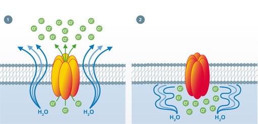

## Cystic Fibrosis

- Cystic fibrosis is caused by a recessive allele that codes for a transport protein called CFTR, causing the production of abnormal thick mucus that is difficult to be removed

- Other body parts such as pancreatic duct can become blocked as well as reproductive ducts causing infertility

- **CFTR effects on lungs:**

  - Due to mucus not being moved effectively by cilia, bacteria and dust accumulate, causing infections
  - Reduces gaseous exchange, by making it a longer diffusion pathway
  - Causes difficulty in breathing
  - Lungs may be scarred

- The **CFTR** gene normally codes for a transport protein that allows chloride ions to pass out of cell.

- **Chloride** ions are essential to be transported out so that they cause a concentration gradient outside, hence causing water to move out of cells by osmosis.

- The **water** mixes with the mucus making it easily removed by the sweeping movement of cilia.

- The **recessive** allele codes for a faulty version of this protein, not allowing Cl$^{-}$ ions to pass out of the cell, so water doesn’t move out and mucus remains thick.