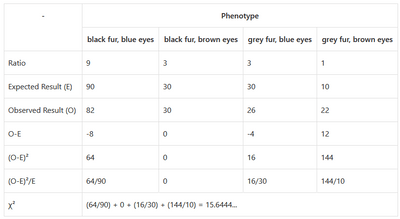
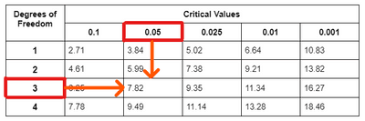

## Chi-Squared (χ²) Tests

* The Chi-squared test is a statistical test used to compare the observed results to the expected results to determine whether there is a significant change.
* **Null Hypothesis**: If there is no significant change, then the results are due to chance.
* The Chi-squared test is used to support or reject the null hypothesis.

### **Calculating for the Chi-squared (χ²) value**

* The formula for the statistical test (it will be given in the exam):

$$

\chi^{2} = \sum \frac{(O-E)^2}{E}

$$

**Example:**

* An investigation was conducted about the inheritance of two characteristics in Siberian Husky dogs: fur and eye colour. Using a dihybrid cross, it is found that the ratio for each character shown in the table below is 9:3:3:1. Two heterozygous individuals were crossed, and the phenotype of their offspring was recorded.
* The null hypothesis can be rejected if the test results conclude that the expected and observed results are significantly different. Otherwise, it is supported.

### Comparing the Chi-squared (χ²) value to the Critical value

* Comparing the Chi-squared value to the Critical value is important to determine whether there has been a significant change.
* The critical value is the probability that the difference between observed and expected results is due to chance.
* The critical value only looks at 0.05 (5%) probability.
* If the chi-squared value is greater than the critical value then there is a significant change between the results, therefore the null hypothesis is rejected.
* If the chi-squared value is smaller than the critical value, then the results have no significant change. Therefore, the null hypothesis is supported.

**Example:**

* From the previous example, we got the chi-squared value of 15.6444…
* We need to determine the degrees of freedom, the number of classes (or number of phenotypes), and subtract 1.
* So, since we had 4 phenotypes, our degree of freedom is 3.
* Using the table below, we can conclude that the critical value for the chi-squared value is 7.82.
* We can reject the null hypothesis Since the chi-squared value (15.6444…) is greater than the critical value (7.82).

