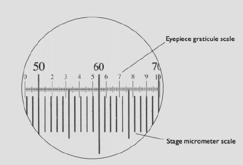
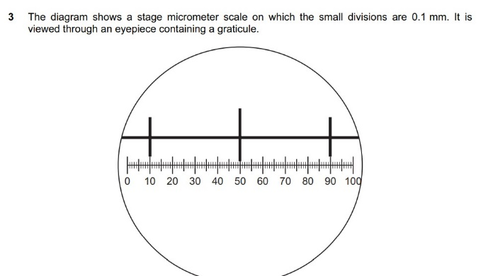
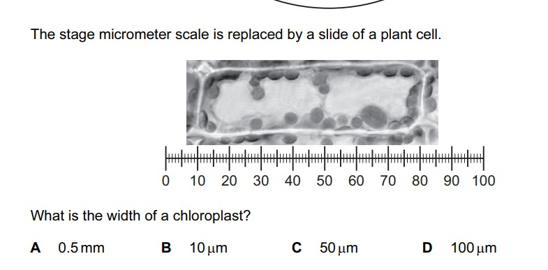

# Cell Structure, Reproduction and Development

## Observing Cells

* Cells are the basic units of all living organisms.
* Organisms can be unicellular or multicellular.
* New cells form by the division of existing cells.
* Cells are too small to be seen by the naked eye, therefore
  microscopes are used to magnify

### **Light Microscopes**:

* Uses light to shine through the specimen, then refracts through
  glass lenses
* An image is projected onto the eyepiece
* Cheap, therefore commonly available in schools
* Quick observation of cells
* Preservation and staining of slides could cause artefacts
* Much lower magnification and resolution compared to electron
  microscopes

### **Electron Microscopes**:

* Uses beams of electrons to create an image
* Electromagnetic lenses form an image
* An image is projected onto a fluorescent screen
* Due to the electron’s low wavelength compared to visible light, high
  magnification and resolution can be achieved
* Specimens are required to be in a vacuum to prevent disturbance of electrons
* Water boils in a vacuum, so the specimen should be dead
* Extremely expensive to buy and maintain
* Specimens must undergo lengthy preparation before use

**Types of Electron Microscopes**:

* **Transmission Electron Microscope (TEM)**: forms two-dimensional
  images
* **Scanning Electron Microscope (SEM)**: forms three-dimensional
  images at the compromise of a lower magnification
* **Magnification**: the number of times larger an image is compared to the object's actual size.
  * Depends on the power of the objective and eyepiece lens used.
* **Calculating magnification:**

* **Eyepiece graticule**: fitted into the eyepiece of the microscope
  and is used to measure objects.

  * Has no units and is calibrated by the stage micrometre, which has an accurate scale (in mm) and provides reference dimensions.

  * 1mm= 1000 μm

  * 1μm= 1000 nm

  * Use the same magnification when calibrating the eyepiece
    graticule and when using it to measure the specimen.

### **Calculation example:**

* 0.1mm of SM = 40 div of EG
* 1 div of EG= 0.1/40
* 0.0025mm*1000= 2.5μm
* 2.5μm*4 egu of chloroplast width= 10μm
* **Resolution:** The ability to distinguish between two separate
  points. The higher the resolution, the higher the detail.
  * Electrons have an extremely short wavelength. This is the main
    reason why electron microscopes have a higher resolution
* Stains are coloured dyes used to make viewing cells/organelles easier.
* Examples of stains include:
  * Acetocarmine: Stains the chromosomes during cell division
  * Iodine: Stains starch-containing organelles in plants

### **Cell Organization Order:**

* **Organelle**: a specialized part of a cell that has its own
  function, e.g. the nucleus
* **Cell**: the smallest part of a living structure that can operate as an independent unit, e.g. red blood cell
* **Tissue**: a group of cells with similar structures working together to perform a shared function, e.g. muscle tissue
* **Organ**: a structure made up of a group of tissues working together to perform specific functions e.g. heart
* **Organ System**: a group of organs with related functions working together to perform body functions, e.g. respiratory system

**Epithelial** cells are tissues that line tubes and other surfaces
in animals.

||Types of Epithelial Cells|
|:---|:---|
|**Squamous**|Simple, flattened, epithelial cells are used to cover surfaces, allowing some substances to pass through, e.g. capillary wall|
|**Cuboidal**|Simple cuboid-shaped epithelial cells used in absorption and secretion, e.g. in water regulation|
|**Columnar**|A simple, columnar epithelial cell which can specialize|
|**Glandular**|A specialized version of columnar cells that secretes chemical substances, e.g. goblet cells|
|**Stratified**|Made up of multiple layers of cells, with the purpose of fast replication, e.g. epithelial cells under the skin|
