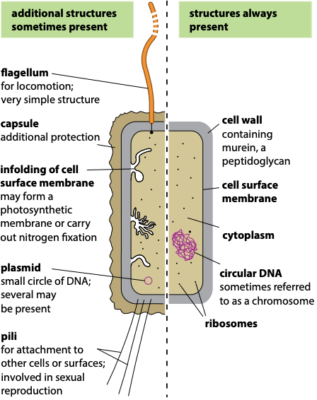

## Prokaryotic Cells

- **Prokaryote:** organisms that lack a nucleus and have simpler
  structures e.g. bacteria.

### **Comparing Eukaryotes and Prokaryotes:**

#|
||

Feature

|

Prokaryote

|

Eukaryote

||
||

DNA

|

Circular, Lies free in the cytoplasm, Is naked

|

Linear, Surrounded by nucleus, Associated with histone, forming chromosomes

||
||

RIBOSOME

|

70S only

|

70S and 80S

||
||

ER

|

Absent

|

Present, to which ribosomes may be attached

||
||

ORGANELLES

|

Very few, No membrane-bound organelles

|

Many, Single, double and no membrane-bound organelles

||
||

CELL WALL

|

Murein, a peptidoglycan (polysaccharide containing amino acids)

|

Cellulose and lignin in plants, Chitin (nitrogen-containing polysaccharide) in fungi

||
||

Cell division

|

Binary fission

|

Mitosis and cytokinesis

||
||

Transcription and translation

|

Simultaneously (as no nucleus)

|

Consecutively

||
|#

