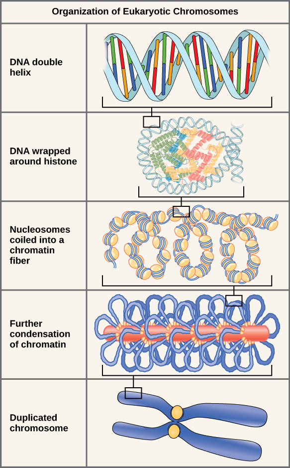
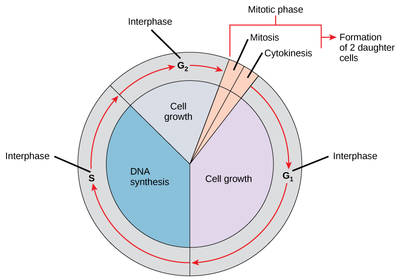
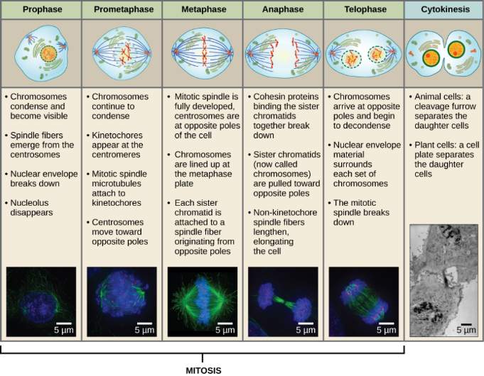

## The Cell Cycle and Mitosis

* **Chromosome**: threadlike structure containing DNA visible during mitosis.
* **Chromatin**: combination of DNA wound around histones proteins (basic).
* **Chromatid**: A single arm of the X-shaped chromosome

### **Stages of the Cell Cycle:**

**Interphase**: cell grows to its normal size after cell division, and
synthesises important substances e.g. proteins.

* **Growth 1 phase:** gap after cell division and before S phase. 46
  chromosomes and chromatids at this phase.
  * Prepares for growth and DNA synthesis (S phase) by producing
    RNA, proteins and enzymes.
  * New organelles are formed.
  * If there are insufficient growth factors, or when cell has
    reached its maximum size, cell will not divide and remain in
    G$\\_1$.
* **S phase**: synthesis of DNA. Each chromosome consists of two
  identical chromatids. 46 chromosomes and 92 chromatids at this
  stage.
  * Chromatin also replicates along with DNA so histones are
    replicated
* **Growth 2 phase:** gap after S phase and before nuclear division
  (prepares for mitosis)
  * New DNA checked, and errors are repaired.
  * Centrioles replicate.
  * Food storage is increased.

### **Mitosis**

* **Mitosis**: nuclear division producing two genetically identical
  daughter nuclei, each containing the same no. of chromosomes as the
  parent.
* **Stages of Mitosis:**

**Note**: nuclear envelope breaks down into vesicles during prophase
and reassembles when the vesicles fuse to form the envelope back at
telophase

* **Cytokenisis:** division of cytoplasm between daughter cells, last
  stage of cell division. It results in the formation of 2 cells.
* **Significance of mitosis:**
  * **Growth:** clones produced allow growth of multicellular organism
    from unicellular zygote.
  * **Replacement of cells and repair of tissues:** cells die and are
    replace; rapid in skin, lining of gut, and to regenerate whole parts
    of body.
  * **Asexual reproduction:** production of a new individual by a single
    parent.
    * In unicellular organisms, cell division results in reproduction.
    * In multicellular organisms, new individuals produced bud off
      from parent.
* **Mitotic Index**: A measure of how actively cells are dividing in a
  given tissue. It is calculates by:

$$
\mathbf{Mitotic\ Index =}\frac{\mathbf{\text{Cells in Mitosis}}}{\mathbf{\text{Total number of cells}}} \times 100
$$