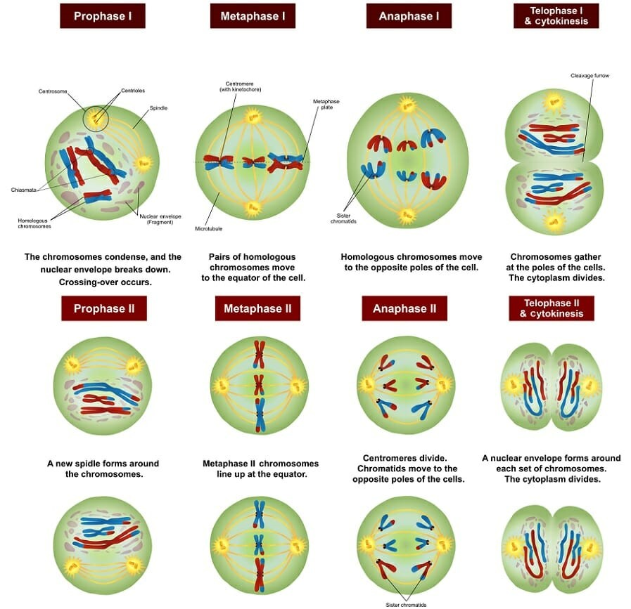

## Sexual Reproduction and Meiosis

* Features of **Sexual Reproduction**:
  * Formation of gametes
  * Uses meiosis cell division
  * Leads to genetic variation
* Disadvantages of Sexual Reproduction:
  * Hard to find mates
  * Resources wasted by forming gametes
* In meiosis, chromosomes are halved from diploid (2n) cells to
  haploid (n) cells
* Thus, chromosome number is kept constant instead of doubling every
  generation

### **Stages of Meiosis**:

### 

* **Independent Assortment:** Occurs during Metaphase I. Pairs of homologous chromosomes lie independently of each other and randomly at the equator, therefore genetically different gametes fuse at random.
* **Crossing-over:** Occurs during prophase I. Homologous chromosomes
  pair up along the length of all four chromatids.
  * **Chiasmata** is formed between bivalent chromosomes, It connects
    with a non-sister chromatid so maternal and paternal genes are
    exchanged
  * Several of these occur resulting in large amounts of variation
  * Some genes are linked which affects how it is inherited in an offspring during crossing-over.
  * Genes located close to each other are strongly linked as they are unlikely to separate during crossing-over, so they are more likely to be inherited together
  * Genes located far from each other are loosely linked as they are likely to separate during crossing-over, so they are less likely to be inherited together.