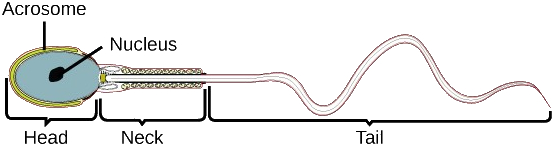
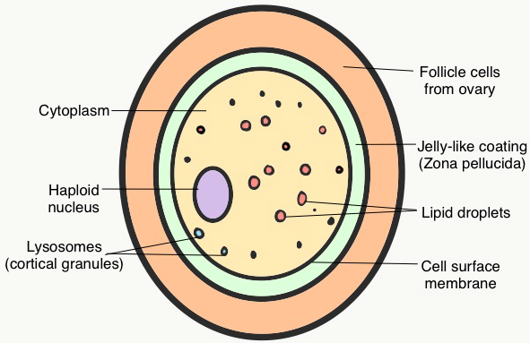

## Gamete Function: Mammals

* **Sperm cell**:

* **Acrosome**: A membrane-bound storage site for enzymes that digest
  the layers surrounding the ovum to penetrate it.
* **Haploid Nucleus**: Contains highly condensed genetic material, containing half the number of chromosomes of the organism. therefore less energy is required to carry it
* **Neck/Middle**: Tightly packed mitocondion is present. They provide
  the energy for lashing the tail to move
* **Tail**: A complex flagellum (9+2 microtubule) that creates a
  whipping motion to propel it forwards
* **Egg cell**:

* **Zona** **Pellucida**: A jelly-like layer surrounding the
  oocyte; controls sperm enterance
* **Cytoplasm**: Stores large amounts of food
* **Follicle Cells**: Surrounds the Zona Pellucida. They are left
  over from the ovulation process.
* **Cortical Granules**: Specialized lysosomes that activate when sperm enters the cell, causing the Zona Pellucida to harden. This prevent polyspermy fertilization

**Lipid Droplets:**

* **Haploid** **Nucleus**: Genetic material, containing half the number of chromosomes of the organism.