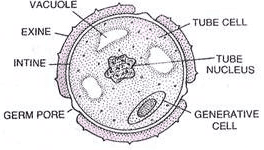
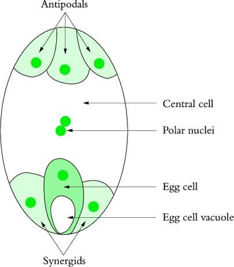

## Gamete Function: Plants

### **Male Gamete (Pollen grain):** 

 

* Only required to know *Tube* and *Generative* nucleus
* **Tube nucleus:** Controls the growth of the pollen tube as well as release hydrolytic (digestive) enzymes
* **Generative nucleus:** Divides by mitosis into two sperm nuclei for fertilisation.

* **Female Gamete (Embryo sac):** 
  * Only required to know *Egg cell* and *Polar nuclei*
  * **Egg cell:** contains half the number of chromosomes of the organism and fuses with one of the sperm nuclei, forming a diploid zygote.
  * **Polar nuclei:** contains half the number of chromosomes of the organism and fuses with one of the sperm nuclei, forming a triploid endosperm.