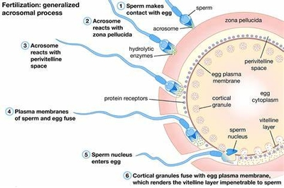

## Fertilisation: Mammals

* Cells surrounding the secondary oocyte release chemicals, attracting
  the sperm cells.
* Once sperm reaches the secondary oocyte, an Acrosome reaction
  occurs.
* Enzymes are released. They begin digesting the follicle and zona pellucid layers.
* The enzymes are released by exocytosis from the sperm head.
* Once digested, the sperm nucleus decondenses. Then, it’s released by exocytosis into the secondary oocyte.
* The cortical reaction takes place, releasing enzymes that cause
  hardening of the zona pellucida. This prevents other sperm cells
  from entering.
* The genetic material is taken into the cell by endocytosis. This
  triggers Meiosis II to form an ovum.
* The haploid nuclei fuse, forming a diploid zygote.

