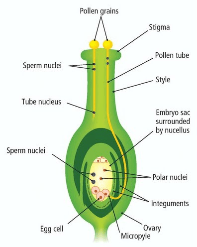

## Fertilisation: Plants

* Once a pollen reaches the stigma surface, it starts germinating
  after absorbing the sugar solution on its surfaces.
* The pollen tube starts growing towards the embryo via chemical stimulus.
* The tube nucleus releases enzymes by exocytosis, allowing the formation of a tube.
* As the tube elongates, nutrients are absorbed along the way.
* The generative nucleus divides, producing 2 sperm nuclei.
* The pollen tube reaches the micropyle (the entrance to the embryo), penetrating the embryo sac wall.
* **Double Fertilisation** occurs, in which 1 nucleus fuses with the Egg cell, forming a diploid zygote. The other nucleus fuses with the 2 polar nuclei, forming a triploid endosperm nucleus.
* After fertilisation, the ovule becomes a seed, The zygote becomes an embryo, and the endosperm becomes food storage.

   

