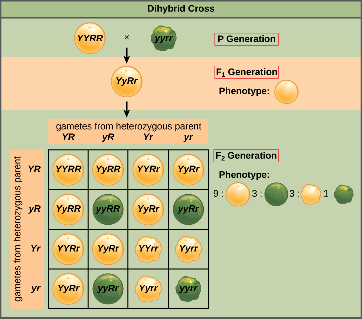
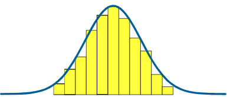
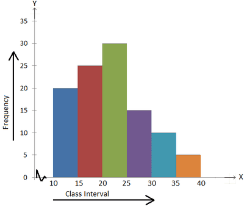
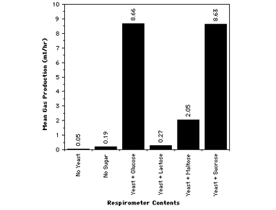
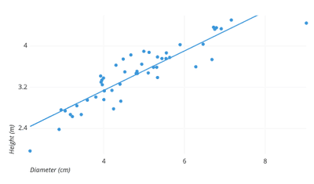

## Cell Differentiation

* Cell differentiation allows the rise of specialized cells.
* Certain genes are surpressed, while others remain active.
* **Locus**: position at which a particular gene is found on a
  particular chromosome.
* **Polygenic inheritance: the** inheritance in which it involves multiple genes at different loci that contribute to the same charactierstics and usually affected by the environment e.g. height.
* **Digenetic inheritance**: Deals with the inheritance of two
  separate genes on different chromosomes at once
  * **They usually invole ratios to be known (9:3:3:1)**
  * During experiments, ratios may be unexpected due to a small
    sample size, experimental errors.

**Variation in phenotypes:**

* Continuous variation - phenotypes that fall within a range of values which is controlled by multiple genes at different loci (polygenic). Ex. height

Graphs that represent continuous variation:

* Normal distribution curves (bell curve) in either line or bar graph 

* Histograms (touching bar graphs) 

* Discrete (Discontinuous) variation - phenotypes that fall in exact categories which is controlled by a single gene (monogenic). Ex. eye colour

Graphs that represent discrete variation:

* Bar graphs (non-touching) 

* Scatter graphs 

