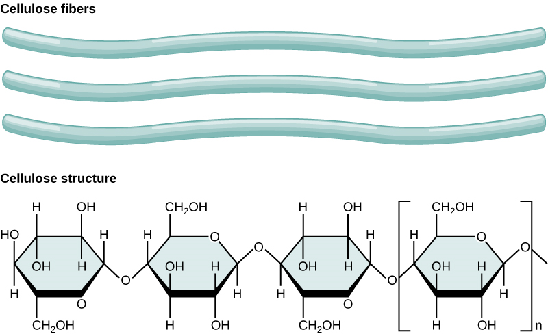

# Plant Structure and Function, Biodiversity and Conservation

## The Cell Wall

* Cells walls are responsible for a plant cell’s strength.
* Plant cells are connected to each other by the middle lamella, which
  is made of pectin.
* The cell wall is made up of cellulose fibres and matrix.
* The matrix is made of hemicellulose and pectin. It helps hold the
  cellulose fibres together.
* Cellulose microfibres contain around 60-70 microfibriles.
* For the transfer of materials between cells, regions called pits
  contain plasmodesmata. This region has no cell wall allowing
  exchange of substances between cells.
* In dead cells, like the xylem, a secondary cell wall is present that
  covers the plasmodesmata. It provides support and rigidity.
* Cellulose found in the cell walls are arranged at different angles and are connected to each other by hydrogen bonds which provides additional support and rigidity as well as waterproof abilities.

### **Celluose**:

* It is a polysaccharide made up of β-glucose molecules
* Hydrogen bonds formed between molecules
* They form long straight chains
* Every other molecules flips, allowing glycosidic bonds to form

