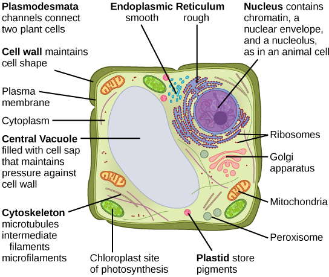
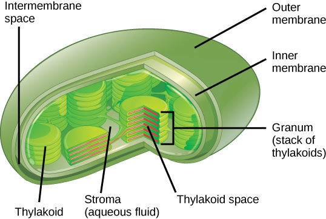

## Plant Organelles

* **Tonoplast**: A membrane that surrounds the vacuole. The vacuole
  contributes to water regulations via osmosis.
* **Amyloplast**: Responsible for startch storage
* **Chloroplast**: It is responsible for producing food in a plant
  cell, it contains many parts:
  * Thylakoid

  * Granum

  * Stroma

  * Starch Grain

  * Ribosomes

