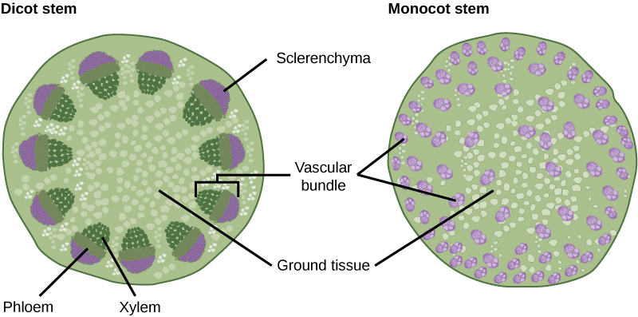
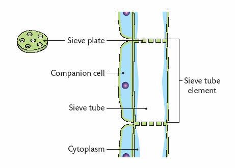

## Plant Stems

- The main function of stem cells is to provide support and a means of
  transportation.

- **Parenchyma** is a packing tissue that is scattered throught out
  the stem. It is unspecialized but can be modified to different cell
  types.

- **Sclerenchyma** is a modified parenchyma that contains lignin. They
  contain pits allowing sideways water flow through out the stem. They
  also have tampered ends.

- **Xylem**: Carry water and minerals from the roots to the leaves.
  Contain pits to allow movement of water between vesicles. Cell walls
  thickened with lignin. Water can move sideways through pits. The
  don’t have tampered ends. Xylem is crucial in providing support to
  the plant.

  - Hollow tubes allowing easy flow of water and minerals

  - Thick lignin walls withstand high pressure

  - Cell contents are removed, increasing flow

- **Phloem**:

  - They are made out of structures called sieve tubes. Unlike Xylem
    cells, phloem cells are living.

  - This means that sieve cell walls are made of cellulose. They
    also contain cell organelles like mitochondrion.

  - A sieve plate forms when 2 sieve cells meet.

  - Companion cells are present with each sieve cell. They have
    normal plant cell organelles.

  - Translocation is the process of transport of sucrose from a
    source to a sink.

