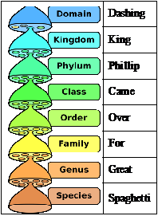

## Principles of Classification

* **Classification:** A way of organising the different types of living organisms based on the similarities and differences between the organisms’ phenotype and genotype.
* **Species:** a group of organisms with similar morphological and
  physiological features, which can interbreed to produce fertile
  offspring and are reproductively isolated from other species.
* **Ecosystem:** a relatively self-contained, interacting community of
  organisms, and the environment in which they live and with which
  they interact.
* **Niche:** is the role of an organism in an ecosystem (it is how an
  organism fits into the ecosystem).
* **Biodiversity:** The variety of species in an area along with their variation **within** species and the genetic diversity **between** them.
* **Taxanomy**: Biologists created a process called classification to
  arrange organisms into groups, as:
* These taxa form a hierarchy which helps to group organisms

* Taxanomy has resulted in the division of organisms into three
  domains:
  * Bacteria
  * Archaea
  * Eukaryota
* Eukaryota are further divided into 4 main kingdoms
  * Protista
  * Fungi
  * Plantae
  * Animalia
* As science advanced, and DNA and protein analysis became more understood, molecular evidence and phylogeny has been used in classifying different organisms instead of the classical approach of morphology and anatomy.
* With the help of DNA analysis by comparing the similarities between organisms by their base sequences or protein structures, it helps us figure out how closely related the organisms and how they should classified.
* Every species on Earth are classified using the “Binomial Nomenclature”, which can also be referred to as its scientific name. For example, the scientific name for humans is *Homo sapiens*.