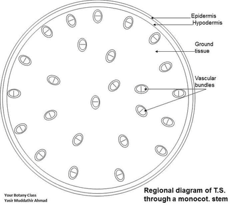
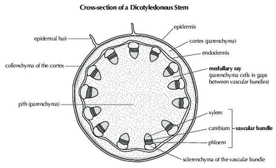
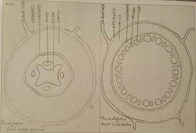
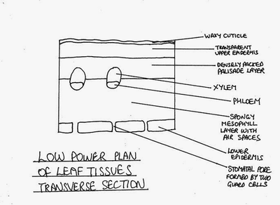

## Plan Diagrams

* In the exam, you may be asked to draw from a provided picture of plants or animals.

**For plants:**

* You may be asked to draw and label plant cells, so knowledge of the common organelles found in plant cells are required.
* You may be asked to draw and label monocotyledon and dicotyledon plant stems, roots and leaves, so knowledge of the parts found in these areas are required.

**For animals:**

* You may be asked to draw and label animal cells, so knowledge of the common organelles found in animal cells are required.

**Drawing:**

* Draw 2-3 times bigger than the provided picture.

* Draw as accurately as to the provided picture as much as possible.

* Draw in a single line—broken lines and sketches are not accepted.

* Shading is not accepted.

* When labeling, use a ruler to draw the line and make sure it clearly shows that it originates from the part that needs to be labelled with no arrowheads.

* Write in all capital letters to make it clear.

* Monocotyledon stem plan diagram:

  

* Dicotyledon stem plan diagram:

* Roots plan diagram:

  

* Leaf plan diagram:

