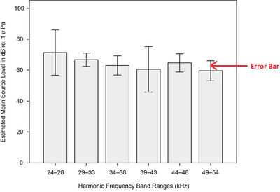

## Standard Deviation

* **Standard deviation:** a measure of spread of data around the mean.

* Standard deviation can be represented on bar and line graphs.

* You may be asked to calculate and represent standard deviation on the graph.

* Standard deviation can be represented on the graph through the use of error bars.

**Standard deviation formula:**

$$

\sigma = \sqrt{\frac{\sum (x-\mu)^2}{n-1}}

$$

* Where:
  * **σ** stands for standard deviation
  * **x** stands for each value in the data set
  * **μ** stands for the mean of the data set
  * **N** stands for the number of values in the data set

**Drawing error bars**

* Error bars are what are found on bar and graphs that look like the letter “I” capitalised.

   

* To draw error bars, you need the mean and standard deviation for each mean value.
* The standard deviation is always given as ± (plus/minus) value
* The lower and upper bound values need to be calculated by mean ± (plus/minus) the standard deviation (μ ± σ).
* It is then graphed where the lower and upper bound are marked with a small horizontal dash, both connected at the centre with a line.
* Calculating the standard deviation is important as when the error bars are plotted, we can tell if there is a significant difference between the data between the categories by seeing if the error bars overlap each other, which makes the data collected more reliable.