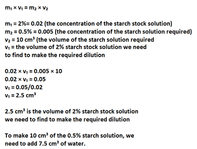

## Dilutions Planning

* In the exam, you may be asked to calculate the volume of stock solution needed to dilute it to the right concentration.

* A formula to help calculate this is as follows: $m_1 \times v_1 = m_2 \times v_2$

  * *m* might be commonly written as *c* too.
  * $m_1$ stands for the concentration of the stock solution
  * $v_1$ stands for the volume of stock solution required
  * $m_2$ stands for the concentration needed at the end
  * $v_2$ stands for the volume of the diluted solution.

* Example:

  * The starch stock solution is 2% concentration and student A needs 0.5% concentration and 10 cm³ of starch solution. Calculate the volume of 2% starch stock solution and water needed to make 0.5% concentration, 10 cm³ of starch solution.

  