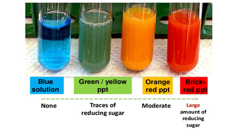

# Experiments

## CP 1 - Benedict's test for reducing sugars and iodine test for starch

### **Benedict’s test for reducing sugars**

**Variables**:

* Independent variable: The concentration of the reducing sugar solutions
* Dependent variable: The colour of the solution after the addition of Benedict’s reagent

**Equipment**:

* Laboratory safety wear: Lab coats, eye goggles, latex gloves.
* Test tubes, test tube rack, tongs
* Water bath at 80°C
* Timer
* Benedict’s reagent
* Distilled water
* Stock solution of a reducing sugar

**Procedure**:

* Plan various concentrations of a reducing sugar from a stock solution with the help of dilutions planning up to 10 cm³ each.
* Pipette only 5 cm³ of the solutions into a separate test tube.
* Add 2 cm³ of Benedict’s reagent into the test tubes.
* Place all of the test tubes gently and carefully into the water bath.
* Start a timer for 2 minutes.
* After 2 minutes, carefully remove the test tubes with the help of tongs and place them on a test tube rack.
* Observe the colour of the solution in each test tube.

**Observations and analysis:**

* Precipitate is formed when Benedict’s reagent as it contains copper ions which gets reduced from Cu²⁺ to Cu⁺, causing the colour change.
* The colours of the solution can be compared to an existing colour scale from blue (which contains no reducing sugar at all) to brick red (which contains a very high concentration of reducing sugars) in order to estimate the concentration of the reducing sugars in the original solution.

### **Iodine test for starch**

**Variables**:

* Independent variable: The concentration of the starch solutions
* Dependent variable: The colour of the solution after the addition of the Iodine solution

**Equipment**:

* Laboratory safety wear: Lab coats, eye goggles, latex gloves.
* Test tubes, test tube rack, tongs
* Iodine solution
* Distilled water
* Stock solution of starch

**Procedure**:

* Plan various concentrations of starch from a stock solution with the help of dilutions planning up to 10 cm³ each.
* Pipette only 5 cm³ of the solutions into a separate test tube.
* Add 2 cm³ of Iodine solution into the test tubes.
* Observe the colour of the solution in each test tube.

**Observations and analysis:**

* Negative result: Brown colour (No starch present)
* Positive result: Blue colour (Moderate amount present) to Black colour (High concentration present)