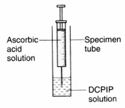
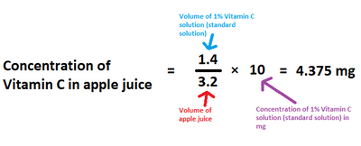

## CP 2 - Investigating the vitamin C content of food and drink

**Variables**:

* Independent variable: The fruit juices
* Dependent variable: The volume required to decolourise the 1% DCPIP solution.

**Equipment**:

* Laboratory safety wear: Lab coats, eye goggles, latex gloves.
* 1% DCPIP solution
* 1% Vitamin C solution
* Different types of fruit juices
* Test tubes
* 1 cm³ and 5 cm³ syringes

**Procedure**:

* Using a syringe, take 1 cm³ of 1% DCPIP solution and place into a test tube.

* Using a syringe, take 5 cm³ of 1% Vitamin C solution and release it into the test tube dropwise (drop by drop).

* Make sure the 1% Vitamin C solution drops into the DCPIP solution directly—do not let it stick to the side of the test tube.

* Continue to do this until the DCPIP decolourises (turns colourless).

* Record the volume of 1% Vitamin C solution used to decolourise.

* Repeat this experiment for different types of fruit juices.

**Observations and analysis:**

* The DCPIP solution is blue in colour.
* Vitamin C is an antioxidant.
* The vitamin C found in fruit juices can be used to reduce the DCPIP solution, causing the decolourisation.
* 1 cm³ of the vitamin C solution contains 10 mg of vitamin C. With this, it is possible to calculate the concentration of Vitamin C required to decolourise a solution of DCPIP by using the following formula:
  * $\text {concentration of vitamin C in fruit juice} = \frac{\text{volume of standard solution}}{\text{volume of fruit juice}} \times \text{concentration of standard solution}$
  * The standard solution would be the experiment using 1% Vitamin C solution.
* **Example:**
  * In an investigation, the volume of 1% vitamin C solution needed to decolourise the DCPIP solution was 1.4 cm³ and the volume of apple juice solution needed was 3.2 cm³.

  