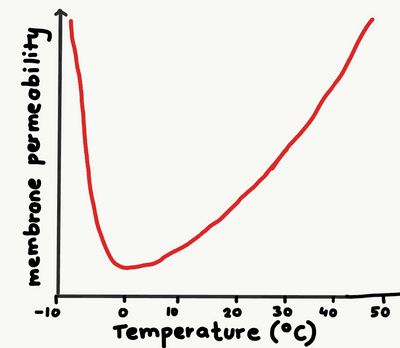
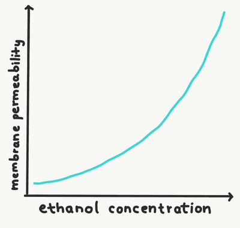

## CP 3 - Investigating membrane properties including the effect of temperature and alcohol

### **Introduction:**

* Beetroot cells contain a pigment called betalain which gives the vegetable its distinct red/pink colour which found inside each cells’ vacuoles.
* Betalain is too large to pass through the cell membrane which makes beetroot perfect for experimenting on membrane permeability, using temperature and alcohol.

### **Testing the effect of temperature on membrane permeability using Beetroot**:

**Variables**:

* Independent variable: The temperature
* Dependent variable: The percentage transmission of light

**Equipment**:

* Laboratory safety wear: Lab coats, eye goggles, latex gloves.
* Test tubes, test tube racks and tongs
* Scalpel
* Cork borer
* Ruler
* Distilled water
* Water bath
* 10 cm³ syringe
* Forceps
* Colorimeter
* Cuvette
* Timer

**Procedure**:

* A set of 8 different temperature water baths is prepared e.g. (0°C, 10°C, 20°C, 30°C, 40°C, 50°C, 60°C ,70°C)
* Beetroot skin is peeled and cut into a cylindrical shape in equal lengths using a cork borer, scalpel and ruler.
* Ensure all sizes of samples of beetroot are equal
* Wash the beetroots with distilled water
* Add 10 cm³ of water to all beakers in the water bath
* Place each sample into a different water bath for 15 minutes
* After 15 minutes, using forceps carefully remove the beetroot without destroying/damaging it
* Place a blue/green filter into the colorimeter.
* Zero the colorimeter using a cuvette filled with only distilled water.
* Place each test tubes liquid into the cuvette and place in a colorimeter and record the percentage transmission of light.
* The colorimeter must be zeroed with distilled water in between each time the different test tube liquids are tested.

**Observation and analysis:**

* < 0°C: ice forms between the membrane which causes holes in the membrane that are large enough to allow the pigment to leak out.
* Between 0°C to 40°C: the phospholipids in the cell membrane gain kinetic energy, allowing it to move more to allow larger gaps that allow the pigment to leak out.
* 40°C: the proteins on the cell membrane start to denature, changing shape and causing gaps in the cell membrane, causing pigment to leak out.

### Testing the effect of alcohol on membrane permeability using Beetroot:

**Variables**:

* Independent variable: The concentration of alcohol
* Dependent variable: The percentage transmission of light

**Equipment**:

* Laboratory safety wear: Lab coats, eye goggles, latex gloves.
* Test tubes, test tube racks and tongs
* Scalpel
* Cork borer
* Ruler
* Distilled water
* Ethanol
* 10 cm³ syringe
* Colorimeter
* Cuvette
* Timer

**Procedure**:

* Using a boiling water bath, set each piece in a different test tube. Each test tube contains different concentrations of alcohol e.g. (0%, 10%, 20%, 30%, 40%, 50%, 60%, 70%), but 10 cm³.
* Beetroot skin is peeled and cut into a cylindrical shape in equal lengths using a cork borer, scalpel and ruler.
* Ensure all sizes of samples of beetroot are equal
* Wash the beetroots with distilled water
* Place each beetroot pieces into the different test tubes and leave for 15 minutes.
* After 15 minutes, using forceps carefully remove the beetroot without destroying/damaging it
* Place a blue/green filter into the colorimeter.
* Zero the colorimeter using a cuvette filled with only distilled water.
* Place each test tubes liquid into the cuvette and place in a colorimeter and record the percentage transmission of light.
* The colorimeter must be zeroed with distilled water in between each time the different test tube liquids are tested.

**Observation and analysis:**

* Ethanol and the phospholipids on the cell membrane are both non-polar, allowing the ethanol to dissolve the phospholipids, which leads to gaps that allow the pigment to leak out.

  