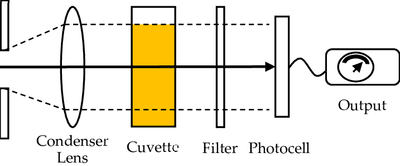
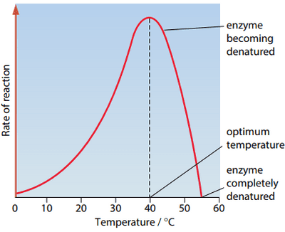

## CP - 4 Investigating the effect of temperature, pH, enzyme and substrate concentration on the initial rate of reaction

**Introduction:**

* Four factors are being investigated in these enzyme-controlled experiments: Temperature, pH, enzyme and substrate concentration.

* Milk is used as it contains a protein called casein that gets digested by enzymes like trypsin.

* Milk is white and opaque and as the protein is digested, the solution gets more translucent which allows for light to pass through more easily.

* A colorimeter is used to see how much light has passed through the solution, so that we can measure the rate of reaction of the experiment.

  

### **Experiment with temperature:**

**Variables**:

* Independent variable: The temperature
* Dependent variable: The absorbance value

**Equipment**:

* Laboratory safety wear: Lab coats, eye goggles, latex gloves.
* Test tubes, test tube rack and tongs
* Water bath
* Timer
* Thermometer
* Pipette
* Distilled water
* Colorimeter
* Cuvette
* 2% Skimmed milk
* 1% trypsin solution

**Procedure**:

* Set the separate water baths to different temperatures on your chosen range of temperatures. (eg. 0°C, 10°C, 20°C, 30°C, 40°C)
* Pipette 2 cm³ of 1% trypsin solution into 5 test tubes and place in each water bath
* Pipette 2 cm³ 2% skimmed milk into 5 different, clean tubes and place in each water bath
* Leave them for 5 minutes, so that they equilibrate (reach the required temperature)
* Pipette 2 cm³ of 1% trypsin and 2 cm³ distilled water into a cuvette to zero the colorimeter
* Remove the 2 cm³ of milk at the first temperature and pour it into a second cuvette.
* Pour the 2 cm³ of 1% trypsin at the first temperature into the second cuvette.
* Quick and gently shake the mixture and then place it into the colorimeter.
* Record the absorbance immediately and then follow by 15-second intervals of recording for 5 minutes or until there is little change.
* Repeat from the step at which the colorimeter is zeroed for different temperatures.

**Observation and analysis:**

* As the temperature increases, the initial rate of reaction also increases as the particles gain energy, so that the substrate and enzyme collide and bind more frequently to form enzyme-substrate complexes.
* At its optimum temperature, it is the maximum point of rate of reaction and increasing the temperature beyond this causes its rate of reaction to decrease as more kinetic energy breaks the bonds in the secondary and tertiary structure of the enzyme.
* This changes the shape of the enzyme and it’s active site and causes the substrate to no longer fit.
* The enzyme is denatured.

### **Experiment with pH:**

**Variables**:

* Independent variable: The pH value
* Dependent variable: The absorbance value

**Equipment**:

* Laboratory safety wear: Lab coats, eye goggles, latex gloves.
* Timer
* Pipette
* Distilled water
* Colorimeter
* Cuvette
* 2% Skimmed milk
* 1% trypsin solution
* Buffer solutions

**Procedure**:

* Pick your chosen range of pH and then buffer solutions for them
* Pipette 1 cm³ of 1% trypsin, 1 cm³ of buffer solution and 2 cm³ distilled water into a cuvette to zero the colorimeter
* Pipette 1 cm³ of 1% trypsin and 1 cm³ of the first buffer solution into a second cuvette.
* Pipette 2 cm³ of 2% skimmed milk into a third cuvette.
* Combine the second and third cuvette.
* Quickly and gently shake the mixture and place it into the colorimeter.
* Record the absorbance immediately and then follow by 15-second intervals of recording for 5 minutes or until there is little change.
* Repeat from the step at which the colorimeter is zeroed for different pH values.

**Observation and analysis:**

* Any change in the pH value of the medium around the enzyme will cause the bonds to be damaged.
* This will change the 3-D shape of the enzyme and deform the active site. Therefore, the substrate will not be able to fit into active site thus the reaction slows down or stops.
* The enzyme gets denatured.

### **Experiment with enzyme concentration:**

**Variables**:

* Independent variable: The enzyme concentration
* Dependent variable: The absorbance value

**Equipment**:

* Laboratory safety wear: Lab coats, eye goggles, latex gloves.
* Timer
* Pipette
* Distilled water
* Colorimeter
* Cuvette
* 2% Skimmed milk
* 1% trypsin solution

**Procedure**:

* Take the 1% trypsin solution as a stock solution and create different concentrations using dilutions planning up to your chosing (eg. 1%, 0.8%, 0.6%, 0.4%, 0.2%)
* Pipette 2 cm³ of trypsin solution and 2 cm³ of distilled water into a cuvette to zero the colorimeter
* Pipette 2 cm³ of 2% skimmed milk into a second cuvette.
* Pipette 2 cm³ of the first trypsin solution into the second cuvette.
* Quickly and gently shake the mixture and place it into the colorimeter.
* Record the absorbance immediately and then follow by 15-second intervals of recording for 5 minutes or until there is little change.
* Repeat from the step at which the colorimeter is zeroed for different concentrations.

**Observation and analysis:**

* As the concentration of enzymes is increased, there are more available active sites for substrates to fit into.
* More enzyme-substrate complexes are formed, more products are formed and the rate of reaction is increased.
* At the beginning, the limiting factor is the enzyme concentration.
* Once all substrates have formed enzyme-substrate complexes, a further increase in enzyme concentration will have no effect on the rate of reaction.
* At this point, the limiting factor is the substrate concentration.

### **Experiment with substrate concentration:**

**Variables**:

* Independent variable: The substrate concentration
* Dependent variable: The absorbance value

**Equipment**:

* Laboratory safety wear: Lab coats, eye goggles, latex gloves.
* Timer
* Pipette
* Distilled water
* Colorimeter
* Cuvette
* 2% Skimmed milk
* 1% trypsin solution

**Procedure**:

* Take the 2% skimmed milk as a stock solution and create different concentrations using dilutions planning up to your chosing (eg. 2%, 1%, 0.75%, 0.5% 0.25%)
* Pipette 2 cm³ of 1% trypsin solution and 2 cm³ of distilled water into a cuvette to zero the colorimeter
* Pipette 2 cm³ of the first skimmed milk solution into a second cuvette.
* Pipette 2 cm³ of 1% trypsin solution into the second cuvette.
* Quickly and gently shake the mixture and place it into the colorimeter.
* Record the absorbance immediately and then follow by 15-second intervals of recording for 5 minutes or until there is little change.
* Repeat from the step at which the colorimeter is zeroed for different concentrations.

**Observation and analysis:**

* As the concentration of substrate increases, the greater the chance of collision with enzymes, the more enzyme-substrate complexes formed, the more products formed and the greater the rate of reaction.
* At the beginning, the limiting factor is the substrate concentration.
* Once all the enzymes are occupied and working at their maximum rate ($V_{max}$), a further increase in substrate concentration will have no effect on the rate of reaction.
* At this point, the limiting factor is the enzyme concentration.

### **Why do we measure the initial rate?**

* There are enough substrate molecules present to ensure that
  substrate concentration is not a limiting reactant
* The substrate concentration is only known at the beginning of
  the reaction