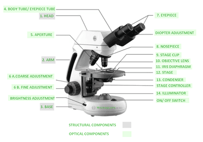
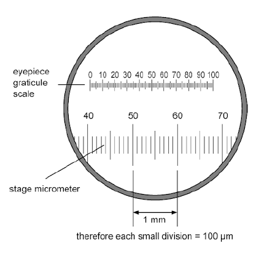
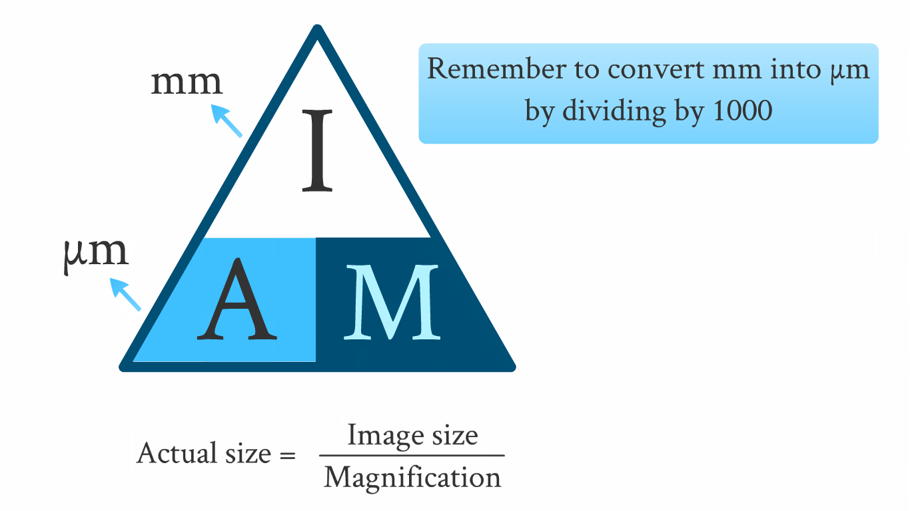

## CP 5 - Using a light microscope to observe and make labelled drawing of animal cells

**Introduction**:

* Eyepiece graticule is a transparent scale with 100 divisions, which
  is placed in the microscope eyepiece.
* Stage micrometer is a transparent ruler which is used to calibrate
  the eyepiece graticule.
* Each division on the stage micrometer is 0.01mm.
* You must also be familiar with parts of the microscope.

* Stains are used to make cell structures visible when viewed under a microscope like Methylene blue.
* In this experiment, we will be use cheek cells which can be easily gathered and observed in a school setting.

### **Calibration of eye piece graticule**

**Procedure**:

* Place a micrometer slide on the stage of the microscope

* Focus on the micrometer scale using the low-power objective
  lens.

* Move the slide and rotate the eyepiece to align the scales of
  the eyepiece graticule and the micrometer scale in the field of
  view

* Count the number of divisions on the eyepiece graticule and
  compare them to a known length on the micrometer scale to figure
  out the length of one eyepiece unit

* Repeat steps 1-3 with the medium-power and high-power objective
  lens.

* **Magnification**: number of times larger an image is compared to the real size of the object.

  * Depends on the power of the objective and eyepiece lens used.

* **Calculating magnification:**

### **Observing and drawing cells:**

**Equipment:**

* Laboratory safety wear: Lab coats, eye goggles, latex gloves.
* Microscope
* Eyepiece graticule
* Stage micrometer
* Microscope Slide
* Coverslip
* Pipette
* Cotton bud
* Disinfectant solution
* Pen
* Paper

**Procedure**:

* Wash your hands
* Take a cotton bud and swab the inside of the your cheeks.
* Take the cotton bud and rub it against a microscope slide.
* Place the cotton bud into a disinfectant solution.
* Add a few drops of the stain (eg. Methylene blue) to the slide.
* Place a coverslip on it.
* Turn on the microscope and set it to low power.
* Bring the lens as close to the slide as possible.
* Using the coarse adjustment on the microscope, slowly move away from the slide.
* After, use the fine adjustment to focus until cells are clearly visible.
* Sketch the cell membrane, using a pen and paper.
* Set the microscope to high power.
* Focus on the indivual cell and make and then draw the organelles.