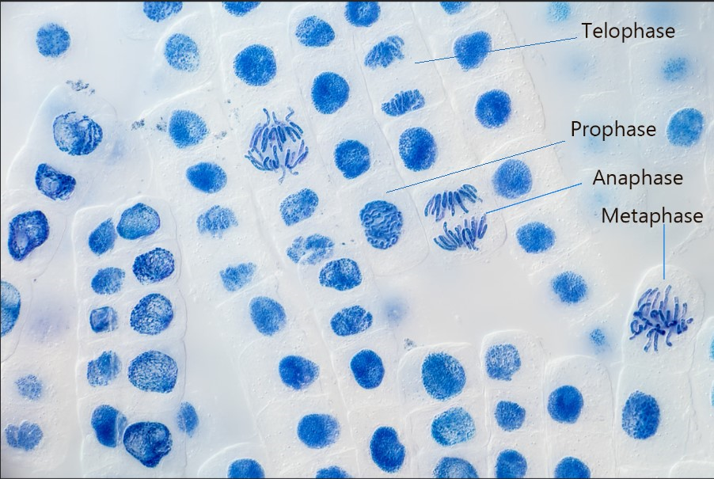

## CP 6 - Preparing a root tip squash to observe the stages of mitosis

### **Equipment**:

* Laboratory safety wear: Lab coats, eye goggles, latex gloves.
* Garlic clove
* Distilled water
* 1 mol of hydrochloric acid (HCl)
* Water bath
* Pipette
* Scalpel
* Forceps
* Timer
* Microscope slide
* Coverslip
* Microscope
* Paper towel
* Acetic orein or Toluidene blue

### **Procedure**:

* Suspend a garlic clove over water for a few days until its root start to grow
* After roots start to grow, use a scalpel to carefully to cut the root tip
* Set the water bath to 60°C.
* Add 10 cm³ of 1 mol of HCl to a test tube and place it into the water bath for 5 minutes
* After 5 minutes, add the freshly cut root tip into the test tube for 5 minutes
* After 5 minutes, remove the test tube and use forceps to carefully extract the root tip.
* Bring the root tip under a tap and wash with distilled water
* Place the root tip on a paper towel to dry
* Place the root tip on a microscope slide and add a few drops of the stain: Acetic orein or Toluidene blue
* Use forceps to macerate the root tip and place a coverslip and cover the whole thing in paper towel.
* Press on the coverslip in order to squash the root.
* Remove the coverslip and place the slide into the microscope for viewing.

### **Observation and analysis:**

* The stages of mitosis can be seen.
* In the plain of view, the mitotic index can also be calculated. 

  