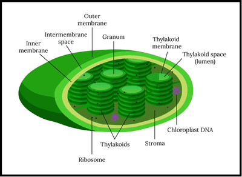

## The Light-Dependent Reaction

* The light-dependent reaction has two parts: cyclic and non-cyclic phosphorylation.

* Photosynthesis takes place in the chloroplast.

### Cyclic photophosphorylation

* Location: thylakoid membrane, usually photosystem 1.

* This reaction requires the presence of light.

### **Steps:**

1. When light hits the leaf and is absorbed by pigments in the photosystem, electrons become excited and move to different energy levels through the electron transport chain via electron carriers.
2. The energy electrons released are used to pass H+ [protons] across the intermembrane space, decreasing the pH as H+ concentration increases.
3. H+ moves down a concentration gradient to the stroma through the ATPase enzyme.
4. Using the energy in the gradient, ATP is synthesised from ADP and inorganic phosphate. [ADP is phosphorylated by adding phosphate groups, which requires energy.]

**Steps 2-4 can be referred to as chemiosmosis.**

### Model question: **What are the adaptations of thylakoid membrane for photosynthesis?** [4]

1. impermeable to H+ so helps maintain a proton gradient

2. photosystems embedded into bilayer to absorb light and emit electrons

3. electron carriers in the membrane allow transport of electrons and release energy

4. membrane contains stalk particles that allow movement of H+ ions to make ATP

### **Non-Cyclic Photophosphorylation**

* Both photosystems 1 and 2 release electrons and chemiosmosis takes place. 

* Electrons are emitted from photosystem 1, and electrons from photosystem 2 fill the gaps in photosystem 1. 

* To replace the electrons lost from photosystem 2, photolysis breaks down water into H+ and e- [protons and electrons] in the presence of light.

* electrons + protons + oxidised NADP ——> reduced NADP

Therefore, reduced NADP [NADPH] and ATP are the products of the light-dependent reaction.