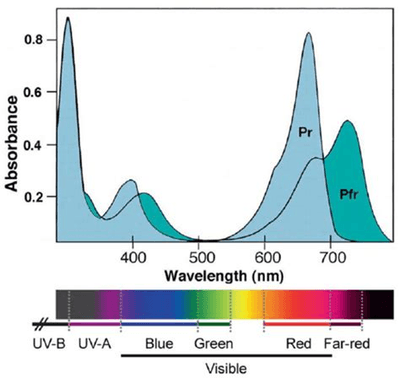

## Important Terms

* The absorption spectrum is a graph showing the amount of light absorbed on one axis and the wavelength of light on the other.

* The action spectrum is a graph that shows the rate of photosynthesis against the wavelength of light.

* Photosystems contain several chlorophyll pigments that absorb a specific range of wavelengths of light, with the two photosystems absorbing different ranges of wavelengths.
* Chlorophyll a, b and carotenoids are common types of photosynthetic pigments.
* The Rf value can be used to determine the pigments contained in a plant and is the ratio of the distance travelled by the pigment to the distance travelled by the suitable solvent.

### **Note:**

* Photolysis and hydrolysis are different.
* Photo=water breaks down into H+ and O2 in the presence of light
* Hydrolysis=a chemical reaction in which water reacts with a compound to produce other compounds; involves the splitting of a bond and the addition of the hydrogen cation and the hydroxide anion from the water