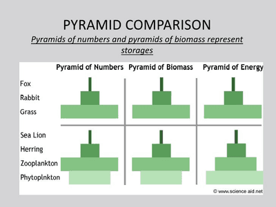

## Ecology

### Key Ecological Terms

* Gross Primary Productivity [GPP] is the rate at which plants make new material by photosynthesis.
* Net Primary Productivity [NPP] is the material produced by photosynthesis and stored as new plant material.

**NPP = GPP - R**

where R: energy losses due to respiration

* Biotic factors = the living elements of a habitat [e.g., predation, disease, resource competition]
* Abiotic factors = the non-living elements of a habitat [e.g., climate, temperature, humidity]
* Ecosystem = both the biotic and abiotic factors of an area interacting with each other in an environment Habitat= place where an organism lives
* Population = group of organisms of the same species living in the same habitat/area at the same time
* Community = several populations of different species living in the same habitat/area at the same time
* Species = a group of organisms with similar characteristics that can interbreed to produce fertile offspring
* Biome = one of the world’s major ecosystems

### Abundance and Distribution

* Controlled by both biotic and abiotic factors.

* Niche=the specific role that an organism plays within its habitat

* **Distribution**=where a species of organism is found in the environment and how it is organized

* **Abundance**=numbers of an organism relative to numbers of other organisms in the same habitat

* Distribution may be uniform, clumped or random depending on resource availability and the hostility of organisms toward each other

* Therefore, an organism's role in its habitat determines how many organisms are present and how many areas it can survive in.

Q) How does isolation reduces gene flow between populations, leading to allopatric or sympatric speciation?

* Habitat fragmentation takes place, leading to isolation→ smaller gene pool→interbreeding→ reduced gene flow

### Trophic levels

* Biomass=the total mass of living matter in a given area or organism

* Energy is lost along a food chain as heat and is used for respiration and growth.

* Food chains start with autotrophic producers.

Q) Why do food chains rarely have more than four trophic levels?

* The energy transferred to the next organism is too small to outweigh energy lost in obtaining prey, as large energy losses take place as heat and used up for respiration and metabolism.

### Succession

**Primary versus secondary succession**

* Primary succession begins with bare land.
* Pioneer species such as moss break down rocks to make a layer of humus which acts as soil.
* Pioneer species can withstand extreme or brutal weather conditions, reproduce and colonize areas rapidly, and have fast life cycles.
* The following species take over the community and change it for the next.
* This continues until a climax community forms.
* A climax community is a relatively stable, self-sustaining ecosystem that will remain untouched until a large, unnatural change, such as a natural disaster, occurs.
* Both primary and secondary succession involve organisms changing conditions to make them more suitable for the following species or organisms, then dying out due to changed conditions or being outcompeted for resources.
* Secondary succession, however, takes place when soil is already present. It often happens after an incident, such as a forest fire, which changes the ecosystem but does not destroy the soil and bedrock.
* It follows the same steps as primary succession.