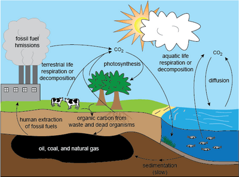

## Climate Change and Conservation

* Climate=average daily weather in a particular area over a given period of time

* Weather=the state of the atmosphere at a given time and place

* Anthropogenic climate change involves a change in an area's daily weather over time due to human activity.

**Evidence for climate change can be found using:**

1. dendrochronology - the dating of past events using tree rings: number of tree rings gives age, thickness gives rainfall and sunlight as is proportional to the rate of photosynthesis in that year

2. records of carbon dioxide levels - CO2 is a greenhouse gas

3. Temperature records - produces a hockey stick-shaped graph. Ice cores are also used. They show warm periods [interglacials] but also that Earth used to be colder, from analysis of oxygen isotopes trapped in melted ice

4. peat bogs - very acidic, cool and anaerobic, so they prevent bacteria from decomposing organic material and preserves pollen grains, moss spores and plant tissues

* Correlation and causation may be observed in the study of the above evidence.

* correlation=change in one variable reflected by change in another variable

* causation=change in one variable responsible for change in another variable

* This data may be extrapolated to predict future trends and plotted on a graph to create a climate change model.

* However, this model will have limitations as there may be changes to data over time.

**Carbon Cycle**

* Carbon sinks absorb more carbon than they release, while sources release more carbon.

* Aiming to be carbon-neutral [produce no net amount of carbon dioxide] is one possible way to reduce climate change.

**The effect of climate change on:**

* Enzyme activity: in extreme cold: decreased kinetic energy→, fewer successful collisions→fewer enzyme-substrate complexes form in high heat: enzymes denatured→active site change shape → more periodic enzyme-substrate complexes form The temperature coefficient (Q10) shows the effect of temperature on the rate of reaction.