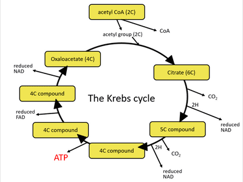

# Respiration, Muscles and the Internal Environment

## Respiration

This is comprised of four steps.

Respiration can happen in the presence of oxygen [aerobic] or in its absence [anaerobic respiration], each involving different steps.

### **Glycolysis**

* It is the beginning of both aerobic and anaerobic respiration.
* It takes place in the cytoplasm
* 2 ATP are used, and four produced, so there is a net [overall] gain of 2 ATP
* A 6-carbon hexose glucose molecule is phosphorylated [has two phosphate groups from ATP added to it] and produces two 3-carbon pyruvates
* 2ADP + Pi → 2ATP and 2NAD → 2NADH for each pyruvate

### **Link reaction**

* It takes place in the mitochondria
* A 3-carbon pyruvate is oxidised
* An NAD molecule reduced to reduced NADH
* This is then decarboxylated as CO2 is released
* coenzyme A + pyruvate → acetyl coenzyme A

**Krebs cycle**

* Also known as the citric acid cycle.

* It takes place in the mitochondria.

### **Oxidative phosphorylation**

* Electrons are transferred from NADH and FADH2 to protein complexes and electron carriers such as NAD, FAD, and cytochrome and move through the electron transport chain
* Electrons are used to create an electrochemical gradient as they are pumped across the intermembrane space
* H+ travels to ATP synthase, powering it to make ATP [phosphorylated]

**What is the difference between substrate-level phosphorylation and oxidative phosphorylation?**

|Substrate level|Oxidative|
|:---|:---|
|A phosphate group is transferred from the substrate to ADP|It uses energy released from electron transfer in the transport chain to generate ATP|
|in mitochondrial matrix|in the inner mitochondrial membrane|
|involved in glycolysis and Krebs cycle|involved in the electron transport chain|
|direct phosphorylation|indirect|

### **The process of anaerobic respiration**

* pyruvate from glycolysis converted into lactic acid
* lactic acid dissociates to form lactate and H+
* produces 2ATP per glucose molecule respired

**Respiratory quotient** = vol of CO2 produced/vol of O2 used