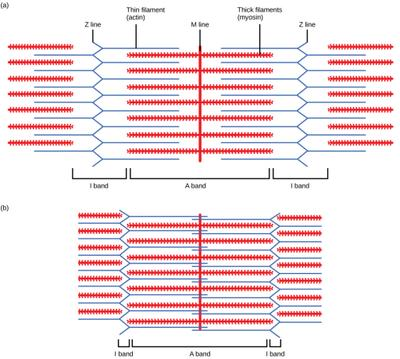

## Muscles

### **Key terms**

* Tendons are inflexible and connect muscle to bone, while ligaments are flexible and connect bone to bone.
* Bones may be compact [dense and heavy, long bones, RBCs are made here] or spongy [open structure]. They are made of collagen and calcium salts in a matrix.
* Joints allow movement and locomotion, producing synovial fluid to reduce friction.
* Ball and socket joints [e.g., shoulder and hip] allow movement in 3 planes, while hinge joints [e.g., knee and elbow] allow movement up and down.
* Antagonistic muscle pairs consist of a flexor and extensor working in opposite directions, so when one contracts, the other relaxes.

Q) Compare the structure and function of slow twitch and fast twitch muscles.

* Slow twitch muscles have: many mitochondria→ allow more aerobic respiration to take place

* many myoglobin molecules→ allows a greater store of O2

* larger capillary network→ allows a good supply of oxygen and glucose

* slow sustained contraction → allows longer periods of training/exercise

* more aerobic respiration, less glycogen, smaller capacity of sarcoplasmic reticulum

### **The electrical activity of myogenic cardiac muscle**

* impulses are sent [frequency varies] from the cardiac control centre in the medulla
* the sinoatrial node in the right atrium establishes a wave of electrical excitation/depolarization→ The atria begin contracting
* the atrioventricular node is excited
* there is a slight delay before depolarization passes into the bundle of His in the septum
* bundle of His splits and carries excitation to Purkyne fibres, which distribute excitation throughout the heart

### **Definitions**

* cardiac output=stroke vol x heart rate= vol of blood pumped in a single unit of time
* tidal volume=vol of air that enters and leaves the lungs at each natural resting breath
* residual volume = volume of air left in the lungs after strongest possible exhalation
* vital capacity = the maximum volume of air that can be discharged from the lungs following maximum inhalation
* stroke volume=vol of blood per beat
* Respiration minute ventilation=vol of gas inhaled [inhaled minute vol] or exhaled from lungs per minute
* breathing rate=number of breaths taken in one minute

### **Sliding filament theory**

* Depolarisation

* Action potential from a motor neuron triggers an impulse from neurotransmitters.

* Triggers the release of acetylcholine, which stimulates Ca2+ ions to get released by the sarcoplasmic reticulum

* Calcium ions bind to troponin and change its shape

* This shifts tropomyosin away and exposes the myosin-binding sites so that actomyosin cross-bridges can be formed

* The hydrolyzed ATP on the myosin head gets released, so action slides over the myosin

* Another ATP binds to the myosin head, and the cross-bridge breaks

* The repeated reorientation of the myosin heads drags the actin filaments along the length of the myosin, shortening the sarcomere.

### **The role of adrenaline in the fight or flight response**

* Baroreceptors in carotid arteries are sensitive to pressure changes and detect when adrenaline is needed
* Sympathetic nerves stimulate the adrenal gland to release adrenaline
* Adrenaline stimulates the cardiac control centre in the brain
* This increases heart and breathing rate, vasodilation, and blood flow and decreases insulin production.