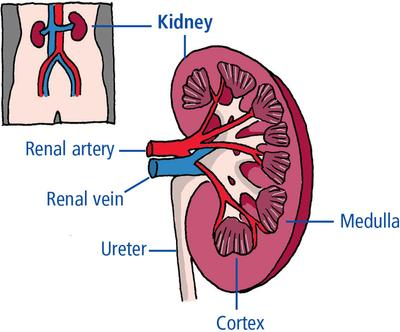
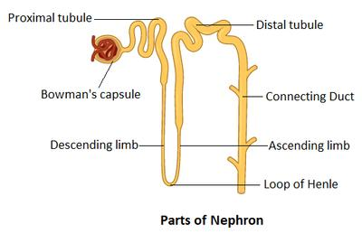

## Homeostasis

* Positive feedback = effectors work to increase the effect/change that triggered the stimulus.
* Negative feedback = results in a decrease in the change of the variable that triggered the response and maintains systems within narrow limits.
* Homeostasis = the process of maintaining a stable internal environment despite changes in the external environment [e.g., insulin, glycogen, and blood glucose]
* Hormones = organic chemicals produced in endocrine glands and released into the blood, which travel to target organs to cause changes.
* Exocrine gland = group of cells that release a substance [e.g., enzymes] into a duct that carries it to where it is needed
* Endocrine gland = ductless releases hormones directly into the blood [e.g., pituitary, thyroid]

### **Control of heart rate**

* Chemoreceptors detect changes in blood pH due to CO2 concentration, and baroreceptors in the carotid artery detect changes in blood pressure.
* Impulses are sent along a sensory neuron to the cardiovascular control centre in the medulla.
* The cardiac control centre increases/decreases the frequency of impulses down sympathetic nerves to the heart.
* The sinoatrial node [SAN] is stimulated to generate more impulses
* Heart rate increases, and blood flow to lungs increases, causing a shorter cardiac cycle
* More CO2 is removed from the blood
* The parasympathetic nervous system then decreases the heart rate if it goes too high beyond specific limits.

### **Control of breathing rate**

* Chemoreceptors in blood detect pH increase or decrease
* Impulses are sent along a sensory neuron to the ventilation centre in the medulla
* Impulses travel along sympathetic nerves
* Intercostal muscles and diaphragm contract, and lungs inflate, increasing the impulses sent
* Eventually, the respiratory centre is inhibited and stops stimulating breathing muscles so frequently.
* Muscles relax and exhale, giving the resting rhythm.

### **The loop of Henle**

It consists of three sections:

1. freely permeable to water, not permeable to NaCl, no active transport, water moves out through osmosis, hypertonic solution, only this step happens in the descending limb
2. very permeable to NaCl, not permeable to water, Na+ and Cl- move out through facilitated diffusion
3. impermeable to water, NaCl pumped out through active transport, more dilute/possibly hypotonic solution

### **Control of mammalian plasma concentration and blood volume**

This is an example of negative feedback.

Given below is the process that occurs when plasma concentration is high.

* Plasma concentration changes
* Osmoreceptors in the hypothalamus send impulses to the pituitary
* The pituitary gland releases ADH
* ADH binds to receptors in the distal convoluted tubule [DCT] and collects duct
* Cyclic AMP is produced as 2nd messenger, and aquaporins move into the cell
* The distal tubule and collecting duct become more permeable to water
* More water is reabsorbed.

Urea is produced by the deamination of excess amino acids and removed through the ornithine cycle [water in, CO2 in→water out].

### **Selective reabsorption**

* It takes place in the proximal convoluted tubule [PCT]

* 80% of filtrate reabsorbed

* Necessary substances [e.g., Na+] are reabsorbed through active transport

* Water and Cl- are reabsorbed through facilitated diffusion and osmosis, respectively, down a concentration gradient

* Only urea, salt, and some water are not reabsorbed

**The layers of the PCT:**

1. endothelium of capillaries
2. basement membrane with collagen and glycoprotein network
3. epithelial cells [podocytes] of the inner lining of Bowman’s capsule

**Adaptations for reabsorption:**

1. covered in microvili→ increases the surface area
2. large number of mitochondria → provide ATP
3. constant blood supply into capillaries → to maintain a concentration gradient

Q) How does the loop of Henle act as a countercurrent multiplier?

* In the loop of Henle, the flow of filtrate in tubules is in opposite directions, because sodium ions are actively transported out of the ascending limb therefore water moves out from the descending limb and solutes move out from the ascending limb due to an increase in the concentration gradient between tubular and interstitial fluid.