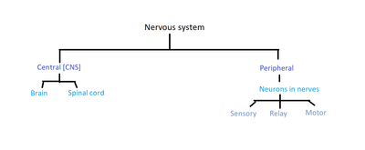
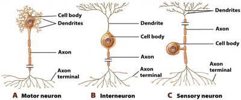
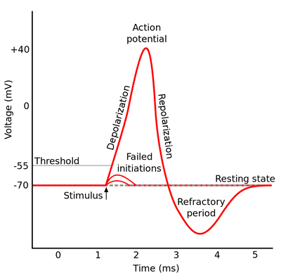

# Coordination, Response and Gene Technology

## The Nervous System

Neurons are nerve cells that help transmit impulses or nerve signals throughout an organism.

There are three types of neurons with varying structure and function.

* Neurons may be coated in a myelin sheath that increases the rate of electrical conduction because impulses can leap from one unmyelinated junction [node of Ranvier] to the next.
* This is known as saltatory conduction.
* Schwann cells do not produce impulses but help conduct impulses to transport them through the nervous system.
* There are two types of Schwann cells: myelinating and non-myelinating.
* The CNS contains both grey matter [unmyelinated] and white matter [myelinated] neurons.

### **How a nerve impulse is conducted along an axon**

### 

### **How a nerve impulse passes through a neuron**

**Step 1-Resting potential**

* At rest, the neuron is polarised.
* The sodium-potassium pump sends Na+ out and K+ in through active transport.
* K+ moves out through the normal potassium pump.
* The potential difference inside the neuron is negative (voltage -70mV), and the outside is positive.
* The membrane is impermeable to Na+ and permeable to K+.

**Step 2-Action potential**

* A change in the membrane's permeability is stimulated before an impulse passes through a neuron.
* Voltage-gated Na+ channels open and Na+ diffuses into the neuron rapidly down its electrochemical gradient.
* K+ move out through the normal potassium pump.
* The inside of the neuron is positive (voltage +40mV), and the outside is negative.
* The neuron is now depolarised, and the impulse passes through.

**Step 3-Refractory period**

* The impulse passes, and voltage-gated Na+ channels close while voltage-gated K+ channels open, through which, through normal potassium channels, K+ move out.
* The neuron is hyperpolarised.

**Step 4-Return to resting potential**

The K+ channels close, and the membrane is repolarised.

**The transmission of an impulse is an all-or-nothing response where +40mV is the threshold that needs to be met for an impulse to pass through.**

### **Transmission of an impulse along a synapse**

* A synapse is a junction across which an impulse is transmitted.
* Calcium ion channels open in the pre-synaptic membrane
* Ca2+ move into the pre-synaptic knob down a concentration gradient
* Vesicles filled with neurotransmitters [e.g., acetylcholine] merge with the cell membrane through exocytosis
* Neurotransmitters are released along the synaptic cleft using energy from mitochondria
* Receptors on the post-synaptic membrane receive neurotransmitters
* One of two responses is triggered:
  * Sodium ion channels open and send Na+ into the fibre
  * The threshold is reached or exceeded
  * Sets up action potential due to a change in potential difference [excitatory post-synaptic potential]
  * The impulse is transmitted
* Or:
  * Different channels open in the membrane, allowing negative ions in
  * An inhibitory post-synaptic potential is set up
  * The action potential will not occur

### **Spinal reflex arc**

This is the pathway through which a reflex travels.

A reflex action is usually involuntary and responds to a specific stimulus.

* A receptor detects a specific stimulus
* An impulse is transmitted to a sensory neuron
* This impulse is then passed on to a relay neuron [in the spinal cord in most higher animals]
* The impulse then reaches a motor neuron.
* This signals an appropriate response to be carried out by an effector [e.g., a muscle]

A monosynaptic reflex arc involves only a sensory and motor neuron, but most reflex arcs follow the abovementioned process and are polysynaptic.

### **Neurotransmitters**

1. Acetylcholine- used by nerves, rapidly hydrolysed and re-synthesised
2. Noroadrenaline
3. Dopamine

### **Drugs and their effects on nerve impulse transmission**

Drugs may either increase or decrease a response.

* **Nicotine**

  * binds to acetylcholine receptors in post-synaptic membranes

  * triggers an action potential in the post-synaptic neuron but receptors remain unresponsive for some time as nicotine binds and doesn’t release for some time

  * causes raised heart rate and down pressure, stimulates the release of dopamine

  * in low concentrations, it has a stimulating effect; in high concentrations, it can kill as acetylcholine is unable to bind

* **Lidocaine**

  * blocks voltage-gated sodium channels

  * prevents the production of an action potential in the sensory nerve

  * prevents you from feeling pain so that it may be used as a local anesthetic or to prevent cardiac arrhythmia

* **Cobra venom alpha toxin**

  * acts as an electron carrier

  * Na+ is not taken up, causing hyperpolarisation

  * decreases the response

  * in small doses, is used to treat asthma by dilating bronchi

  * in large doses, paralyses muscles as they are unable to contract