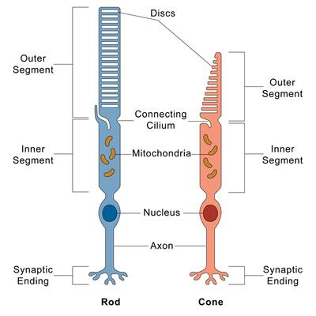

## Response

### **Receptors**

* Primary- a dendrite is sensitive to one stimulus, and an action potential is caused in the neuron.
* Secondary- a receptor on a separate cell synapses with a sensory neuron and transmits an impulse to the CNS.
* Generator potential does not follow the all-or-nothing law.
  * Na+ moves along concentration and electrochemical gradients when a receptor cell receives a stimulus.
  * A generator potential is set up.
  * The greater the frequency of impulses, the greater the generator's potential
* Convergence- when generator potentials from several different receptors add up and trigger an action potential

### The Eye

**Rods and cones**

The retina is comprised of rod and cone cells.

**Rods**

* are spread evenly across the retina except in the fovea [blind spot]
* provide black-and-white vision
* very sensitive to light and movement
* not very tightly packed together
* produce an unclear image as several rods need to be stimulated at the same time to create an action potential, but only a small stimulus is needed
* due to synaptic convergence, low acuity but high sensitivity to light

**Cones**

* densely packed across the fovea
* great visual acuity [very clear vision] because each cone synapses with a single bipolar neuron
* give colour vision
* needs direct light, not very sensitive to light as there is no convergence

### The Cranial Reflex

* On the rods, the visual pigment rhodopsin comprises opsin and retinal.
* Retinal exists as cis-retinal in the dark
* When light hits, this is converted to trans-retinal
* Rhodopsin then experiences bleaching and splits into opsin and retinal
* This causes a generator's potential
* Sodium ions are not taken up, causing hyperpolarisation in rod cells
* Cation channels in bipolar cells open and become depolarised
* This generates an action potential in the neuron of the optic nerve

If a person enters dim  light from bright light, nothing is seen until cis-retinal is regenerated and rhodopsin is formed from opsin and retinal using ATP

### Habituation

**Habituation is the decline in response to a stimulus due to repeated exposure to said stimulus.**

### Plant hormones

* **Auxin** -

  * is present in a high concentration on the side of a shoot or plant, getting less light

  * regulate gene expression through transcription factors [choosing which genes are expressed and switched off]

  * cause cell elongation in the side of a plant getting less sunlight, causing it to grow towards the light

* **Gibberellin -**

  * responsible for seed germination

  * cause hydrolysis of stored starch by triggering amylase synthesis

  * stored in the aleurone layer

* **Phytochrome** -

  * is a blue-green pigment that has two forms

  * phytochrome red is the inactive form, while phytochrome far red is the active form

  * Phytochrome red absorbs red light in the region 660nm and gets converted to phytochrome far red, which is present at the end

  * Similarly, phytochrome far-red absorbs far-red light in the region 730nm and gets converted to phytochrome red, which is present at the end

  * Normal daylight has more red light, so more P FR is present as more P R is rapidly converted.

  * A surplus of P FR induces rapid responses, promotes flowering in long-day plants, and inhibits flowering in short-day plants

  * A surplus of P R induces long-term responses such as internode elongation and inhibits chlorophyll formation, leading to etiolation

### Nervous vs. hormonal control

|Nervous|Hormonal|
|:---|:---|
|Quick response|Varying response speed|
|Information is transmitted as nerve impulses|Transmitted through hormones|
|Impulse transmission occurs through nerve fibres|Hormone transmission occurs through blood|
|Targets a specific direction [e.g., effector, CNS]|Released to blood and taken to the specific receptor through circulation|
|Short term effect|Long-lasting effect|
