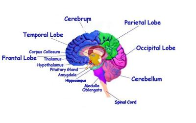

## The Human Brain

### 

### **Function**

* Cerebral hemisphere - voluntary control of the body
* Cerebrum - control of voluntary behaviour
* Cerebellum - muscle movements, coordination of voluntary movements, and balance
* Medulla oblongata - controls heart rate/beat, breathing rate and blood pressure
* Hypothalamus - thermoregulation, hormone production [e.g., ADH]
* Pituitary gland - endocrine gland that produces and releases hormones

### Types of brain scanning

* CT Scan

  * uses X-ray radiation

  * produces cross-sectional images

  * shows damaged/abnormal areas

* MRI Scan

  * uses a magnetic field and radio waves

  * images soft tissues

  * investigates brain structure and function

* fMRI Scan

  * the brain is seen in action, performing tasks

  * the oxygen uptake of respiring areas is monitored

* PET Scan

  * radioactive tracer with glucose is administered to the patient and taken into respiring cells

  * positrons emitted from glucose produce gamma rays that are detected and converted into an image

  * shows cancerous cells clearly as they absorb more radiation

### Illnesses caused by an imbalance of brain chemicals

**Parkinson’s disease**

Characterized by a loss of dopamine-secreting nerve cells in the midbrain.

Symptoms:

* begins with a tremor in one hand
* muscle stiffness and slowness of movement spread throughout the body
* dopamine-secreting cells in the basal ganglia die

Treatment:

1. Monoamine Oxidase B inhibitors [e.g., selegiline] inhibit MOB, breaking down dopamine
2. Drugs [e.g., L-Dopa] can cross the blood-brain barrier due to a transport protein [unlike dopamine] and increase the dopamine levels in the brain
3. Dopamine agonists activate receptors by binding at synapses and triggering an action potential

**Depression**

A decrease in serotonin levels in the brain

Symptoms:

* loss of interest in day-to-day activities
* changes in behaviour
* changes in mood and feelings

Treatment:

1. Medication, e.g., Selective Serotonin Reuptake Inhibitors, slow down serotonin reuptake into the pre-synaptic neuron so more impulses travel along the post-synaptic neuron.
2. Psychotherapy