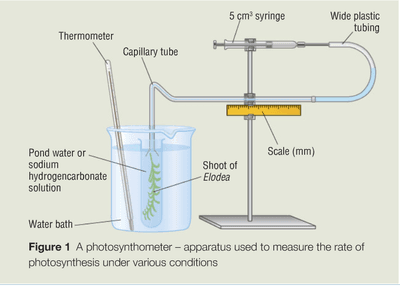

# Core Practical 10

## Investigating the effects of light intensity, light wavelength, temperature and availability of carbon dioxide on the rate of photosynthesis

### **Variables:**

Independent- Light intensity/wavelength/temperature/availability of CO2

Dependent-Volume of gas produced

### **Equipment:**

* eye protection
* pondweed pieces of the same age, size and species
* beaker of water
* sodium hydrogencarbonate
* aluminium foil, paperclip
* spatula, ruler, thermometer, stop clock
* light filters
* photosynthometer
* bench lamp
* balance
* water baths of water at five different temperatures

### **Procedure \[for testing light intensity\]**

* Place a piece of pondweed of known length in a beaker of water and remove bubbles by running a finger and thumb over its surface.
* Cover one side of the beaker with aluminium foil, add half a spatula of sodium hydrogencarbonate and leave for 5 minutes.
* Position the bench lamp 10cm from the beaker and leave to equilibrate for 5 minutes. Fill the photosynthometer’s capillary tubing with water.
* Place the funnel end in the beaker and position the pondweed so its cut end is at the top of the funnel opening. The paperclip can be attached to the other end of the pondweed to help weigh it down.
* Start the stop clock as oxygen bubbles begin to form. After a suitable time, draw oxygen produced into the capillary tubing using the syringe and record the volume of gas produced.

This procedure can be modified and repeated using the other equipment to test for the effect of light wavelength \[using light filters\], temperature \[using water baths\] and availability of carbon dioxide on the rate of photosynthesis.

### **Observations and Analysis**

 

Rate of Photosynthesis = volume of oxygen produced/time taken.