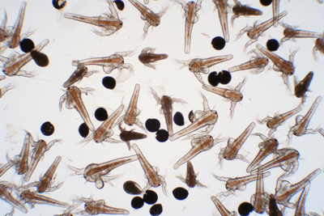
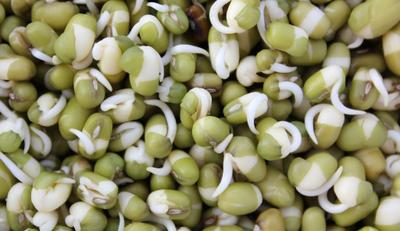

## Core Practical 12

### **Investigating the effects of temperature on the development of organisms**

**If using brine shrimp, Equipment:**

* brine shrimp egg cysts
* 2g sea salt
* dechlorinated water
* 100cm3 measuring cylinder
* six 250cm3 beakers
* stirrer, waterproof marker, thermometer, forceps, pipettes, graph paper
* water baths [25,30,35 degrees Celsius] and refrigerators [15, 20 degrees Celsius]
* lamp

**Procedure**:

* Label the five beakers with the temperatures [15,20,25,30,35 degrees Celsius].
* Dissolve the salt in 100cm of dechlorinated water using the stirrer.
* By dampening graph paper and sprinkling eggs, count 40 eggs and cut the piece around the eggs.
* Place the paper face down into the first beaker and leave for 2 minutes for the eggs to fall into the water. Repeat for each beaker, then place each beaker in the corresponding water bath or refrigerator.
* Prepare another beaker by dissolving 2g of salt in 100 cm3 dechlorinated water.
* To count the shrimp, place a lamp next to each beaker, remove the shrimp that swim towards the light using a pipette and put them in the beaker, then record the number of hatched brine shrimp at each temperature in a table.
* Repeat counting the number of hatched shrimp daily for three days.
* After the experiment, treat the brine shrimp ethically by releasing them into a nearby water source such as a pond or lake. Do not kill them.

**If using seedlings, Equipment**:

* suitable seeds
* distilled water
* 100cm3 measuring cylinder
* Petri dishes
* cotton wool, marker, forceps, thermometers
* incubators [25,30,35 degrees Celsius] and refrigerators [15, 20 degrees Celsius]

**Procedure**:

* Label the five Petri dishes with the temperatures [15,20,25,30,35 degrees Celsius].
* Add a layer of cotton wool about 1cm thick to the bottom of each dish, then add 20 evenly spread seeds and 30 cm3 of water to each.
* Place each dish in the corresponding incubator or refrigerator, leave for 24 hours and then add another 20cm3 of water to each dish. Check dishes every 24 hours to ensure they do not dry out and add an equal volume of water to all dishes as needed.
* After 5 days, observe the seeds and record the number that have germinated in each temperature in a table.