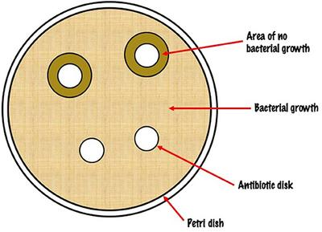

## Core Practical 14

### **Investigating the effect of different antibiotics on bacteria**

**Equipment**:

* eye protection
* Petri dishes with agar seeded with a known bacterium
* Bunsen burner
* samples of different antibiotics on filter paper discs
* forceps, adhesive tape, disinfectant, ruler
* incubator

**Procedure**:

* Follow aseptic methods to disinfect your workbench and apparatus.
* Label an agar plate with the date and the different antibiotics.
* Using the forceps, place each filter paper disc on the agar some distance apart. Before picking up a new disc, hold the forceps to the Bunsen flame to sterilise.
* Cross-tape the Petri dish and incubate at 30 degrees Celsius for 24 hours.
* With the lid on, measure the diameter of inhibition zones around the discs.

**Observations and analysis:**

