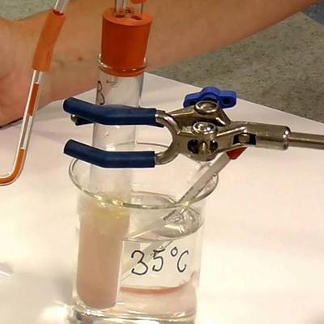

## Core Practical 15

### **Using an artificial hydrogen carrier [redox indicator] to investigate respiration in yeast**

**Equipment**:

* eye protection
* actively respiring yeast suspension
* 0.5% triphenyl tetrazolium chloride [TTC] solution
* distilled water, five water baths, crushed ice
* graduated pipettes, 10 test tubes and a rack
* glass rods, thermometer, stop clock

**Procedure**:

* Choose five different temperatures [e.g., 10,20,30,40,50 degrees Celsius] and set each water bath to a different temperature, then leave for 5 minutes.
* Using the pipette, place 10cm3 of the yeast suspension into each of the 5 test tubes, then place each tube into one water bath.
* Add 1cm3 of TTC to each of 5 test tubes, then place each tube into one water bath. Leave for 5 minutes to allow the solutions to equilibrate.
* Pour the TTC solution into the test tube containing the yeast suspension, stir with a glass rod, return to the water bath, and then start the stop clock.
* Stop the clock when the solution turns red.

**Observations and Analysis**

Temperature affects yeast's respiration rate because the enzymes involved in respiration work best at their optimum temperature. If the temperature is too high, enzymes may be denatured; if the temperature is too low, the kinetic energy of molecules decreases.