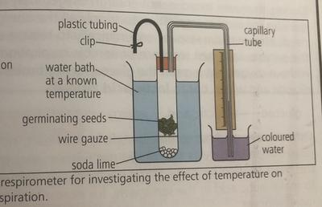
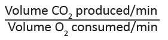

## Core Practical 16

### **Using a simple respirometer to determine the rate of respiration and RQ of a suitable material, such as small invertebrates or germinating seeds**

**Equipment**:

* eye protection
* respirometer
* small live invertebrates [e.g.: woodlice, maggots] or actively respiring germinating seeds [e.g.: mung beans, peas]
* soda-lime
* coloured manometer fluid
* spatula
* stop the clock, thin marker pen
* clamp and stand
* pipette
* balance

**Procedure**:

* Set up the respirometer according to the diagram above and place a known mass of the organism being tested into the boiling tube of the respirometer, leaving the tap open.
* Note the reading on the respirometer at the start of the experiment.
* Close the tap and start the stop clock.
* Note the position of the fluid every 1 minute for 5 minutes.
* Calculate the distance travelled by the fluid and record the results in a table.

**Observations and analysis:**

The respirometer measures the uptake of oxygen by respiring organisms. The experiment can be repeated with and without soda-lime and the difference in gas volume can be calculated to obtain the volume of carbon dioxide, which could be used to calculate RQ [respiratory quotient] using the equation:

