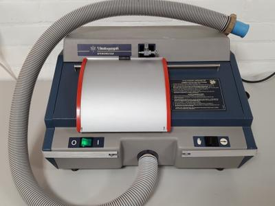

## Core Practical 17

### **Investigating the effects of exercise on tidal vol, breathing rate, etc., using data from spirometer traces**

**Equipment:**

* spirometer
* kymograph
* disinfectant
* eye protection
* soda-lime

**Procedure**:

1. Fill the spirometer with oxygen, attach a disinfected mouthpiece and switch it to the “open” or “air” position.
2. A healthy volunteer must place a nose clip on their nose, the mouthpiece in their mouth and breathe normally for a few seconds to adjust to the apparatus.
3. Turn on the kymograph, move the switch to the “chamber” position, and allow the volunteer to breathe normally for 30 seconds.
4. Switch the spirometer back to the “air” position and switch off the kymograph.
5. Purge the chamber by returning the spirometer to the “chamber” position, lifting the floating part and allowing it to drop a few times.
6. Refill the chamber with oxygen.
7. Allow the volunteer to exercise for 60 seconds.
8. After completing the exercise, the subject should put in the mouthpiece and repeat step 3.

**Observations and analysis:**

* To calibrate the spirometer, use a gas syringe of a known volume.
* Measure tidal volume, breathing rate, respiratory minute ventilation, and oxygen consumption from spirometer trace data.