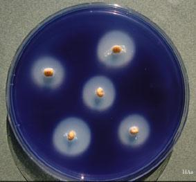

## Core Practical 18

### **Investigating the production of amylase in germinating cereal grains**

**Equipment**:

* Laboratory safety wear: Lab coats, eye goggles, latex gloves
* Cereal grains
* 3% sodium hypochlorite bleach
* Muslin
* Small beakers, volumetric glassware and measuring cylinders, marker pen
* Scalpel
* Forceps
* Tile
* Gibberellic acid 1gdm^-3 stock solution
* Distilled water
* Petri dishes with starch agar adhesive tape to seal

**Procedure [must be conducted over three days]**

Day 1

1. Makeup 5 gibberellin solutions to the appropriate concentration, using a small volume of 5cm3 of each.

→ A stock solution 1gdm-3 will be provided, and the equation c1v1=c2v2 can be used.

1. Collect suitable cereal grains [e.g., 10] and remove the husks.
2. Cut each seed in half horizontally and discard the half containing the embryo [this will be the more pointed half].
3. Sterilise the endosperm halves in 3% sodium hypochlorite for 5 minutes, removing contaminants.
4. Wash the seeds several times and drain until no sodium hypochlorite remains.
5. Place an equal number of seeds into each gibberellin solution [e.g., 2 in each] and leave for 24 hours with the tops of the beakers slightly open to allow oxygen to enter.

Day 2:

1. Collect one sterile Petri dish containing starch agar for each of your planned concentrations and label them on the underside. Using sterile forceps, place a number of seed halves onto the agar with the cut face down
2. Tape each lid with two pieces of tape and incubate for 24-48 hours

Day 3:

1. Remove the Petri dishes from the incubator, and add potassium iodide over the agar to stain it.
2. Measure the diameter of the clear zone around each seed.
3. Record your observations in a suitable table.

**Observations and analysis**

At specific concentrations, Gibberellin stimulates the production of amylase by the aleurone layer around the endosperm. This hydrolyses starch to maltose. Iodine stains only starch-containing areas blue-black.