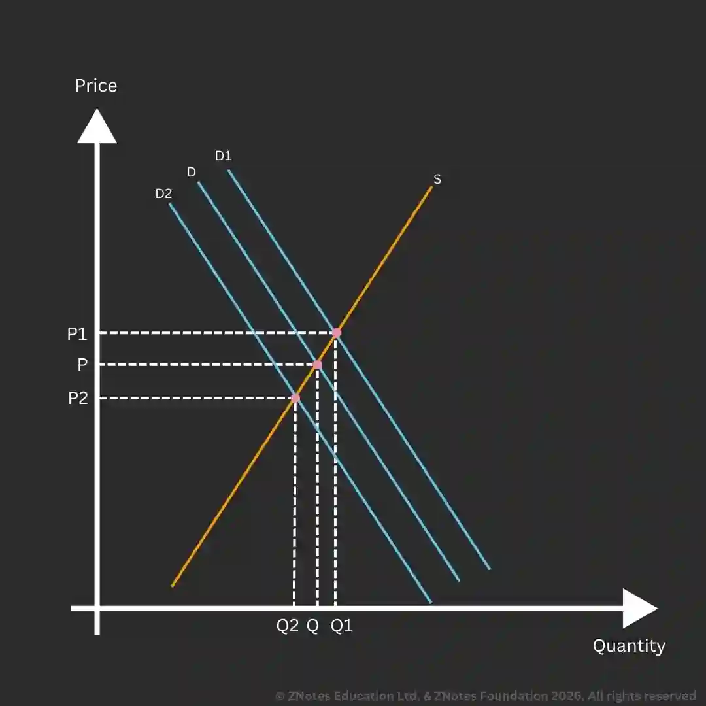

# The Market

## Demand

* **Demand**: the amount of a product that a customer is willing and able to buy at a given price and within a given time period

* The demand curve slopes from left to right.
* An increase in demand is shown by a shift to the right, and a decrease is shown by a shift to the left.
* The change in quantity demanded is illustrated by  movement along the demand curve.
* D1 shows an increase in demand, and D2 shows a decrease in demand.

### Factors Influencing Demand

* **Price of substitutes**: A rise in the price of a substitute leads to an increase in demand for a similar good, as consumers substitute toward the lower-priced option. Eg: a rise in the price of a can of Coca-Cola will increase demand for Pepsi as Pepsi remains relatively cheaper.

  * **Substitutes**: a similar product/service that meets the needs of customers

* **Price of complements**: if the price of a complement decreases, the demand for both goods is likely to increase. Eg: decrease in the price of petrol can increase the demand for petrol as well as the demand for cars run using petrol

  * **Complementary goods**: goods consumed together

* **Changes in consumer incomes**: an increase in income will increase the purchasing power (ability to buy) of a customer, thus increasing demand.

* **Fashion, tastes, and preferences**: these are volatile elements that are responsible for frequent shifts in demand. E.g., the fashion industry changes every time a new style is discovered.

* **Marketing, advertising, and branding**: adverts and brands can be used to change customer opinions and influence their purchases.

* **Demographic**: as the population grows, so does demand. Demand may also grow in different population structures (age, sex, geographical area), e.g., an increase in birth rate will increase the demand for diapers.

* **Seasonality**: goods that have high demand during particular times of the year, e.g., ice cream has high demand in summer and low demand in winter.

* **External shocks**: increase competition (customers flock towards larger firms), government (increased taxes to decrease spending), economic climate (better economic conditions increase demand), and social views (social media).