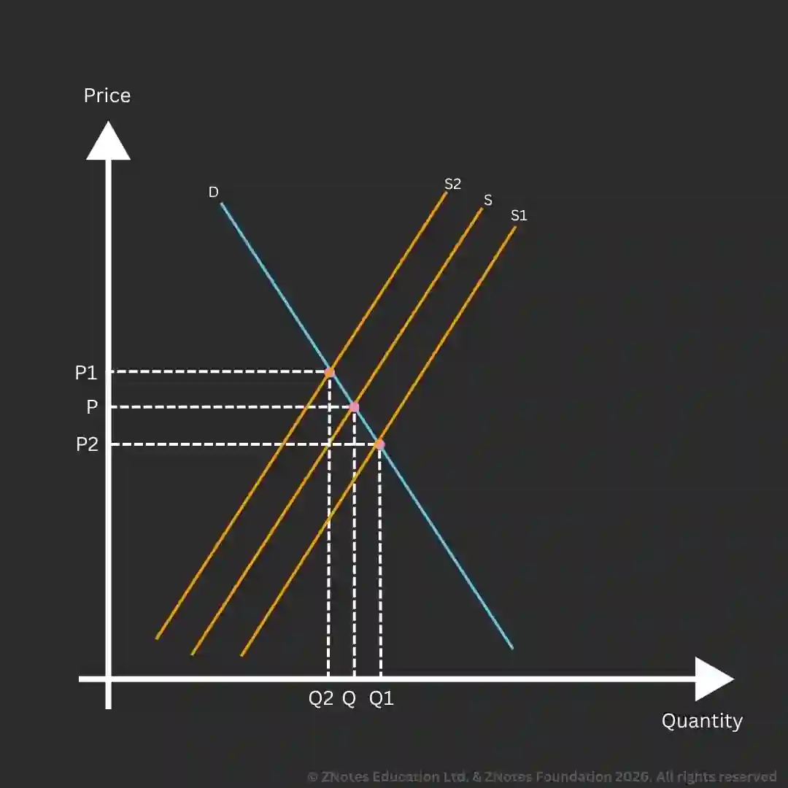

## Supply

* **Supply**: the willingness and ability of a producer to sell a good/service at a given price, during a given time period.

* The supply curve slopes down from right to left.
* An increase in supply is shown by a shift to the right, and a decrease is shown by a shift to the left.
* A change in the quantity supplied is illustrated by a movement along the supply curve.
* S1 shows a decrease in supply, and S2 shows an increase in supply.

**Factors Influencing Supply**

* **Changes in Cost of Production**: An increase in costs will reduce supply as there will be a cut in profit.

* **Introduction of New Technology**: Increases supply as production is more efficient.

* **Indirect Taxes**: Reduce supply as costs to producers increase, which lowers profitability.

* **Subsidies**: Increase supply as firms are encouraged to produce a product.

  * **Subsidies**: an amount of money given to producers by the government

* **External Shocks**: World events (recessions can decrease supply due to low demand), weather (supply of agricultural products is mainly affected), government (increase in interest rates will cause a decrease in supply), price of related goods (leads to an increase in supply as sellers can increase profit from higher prices).