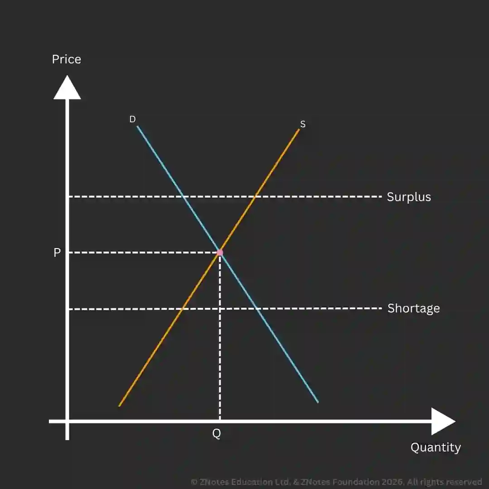

## Market

### Interaction between Demand and Supply

* **Equilibrium price** is defined as the point on the consumer and producer curves, where known as the market-clearing price. This is because the demand is fully met by the consumer.
* The point where demand and supply interact is known as the equilibrium.
* Equilibrium occurs when the quantity demanded meets the quantity supplied at a given price.
* P represents the price that customers and sellers agree to buy/sell the product at.
* Q represents the quantity that is sold at the particular price.

### Changes in Demand and Supply

* As demand increases, so does price. This is the reaction of the market to rising consumer demand.

* If supply increases, price decreases, causing a shift in the equilibrium price.

* Demand and supply can change at the same time. However, it is not known what will happen to price and quantity unless we precisely know by how much demand and supply shift.

### Disequilibrium in the Market

* **Equilibrium**: The intersection between Curve D and Curve S. The quantity demanded is equal to the quantity supplied.

* **Excess demand**: During excess demand, there is a shortage of goods in the market. This leads to a rise in the price of the good. This is more likely to happen if the price was below the equilibrium previously.

* **Excess supply**: If the price is charged above the equilibrium, demand and supply are unequal again. During a surplus, goods tend to remain unsold in large quantities, leading to a fall in prices.